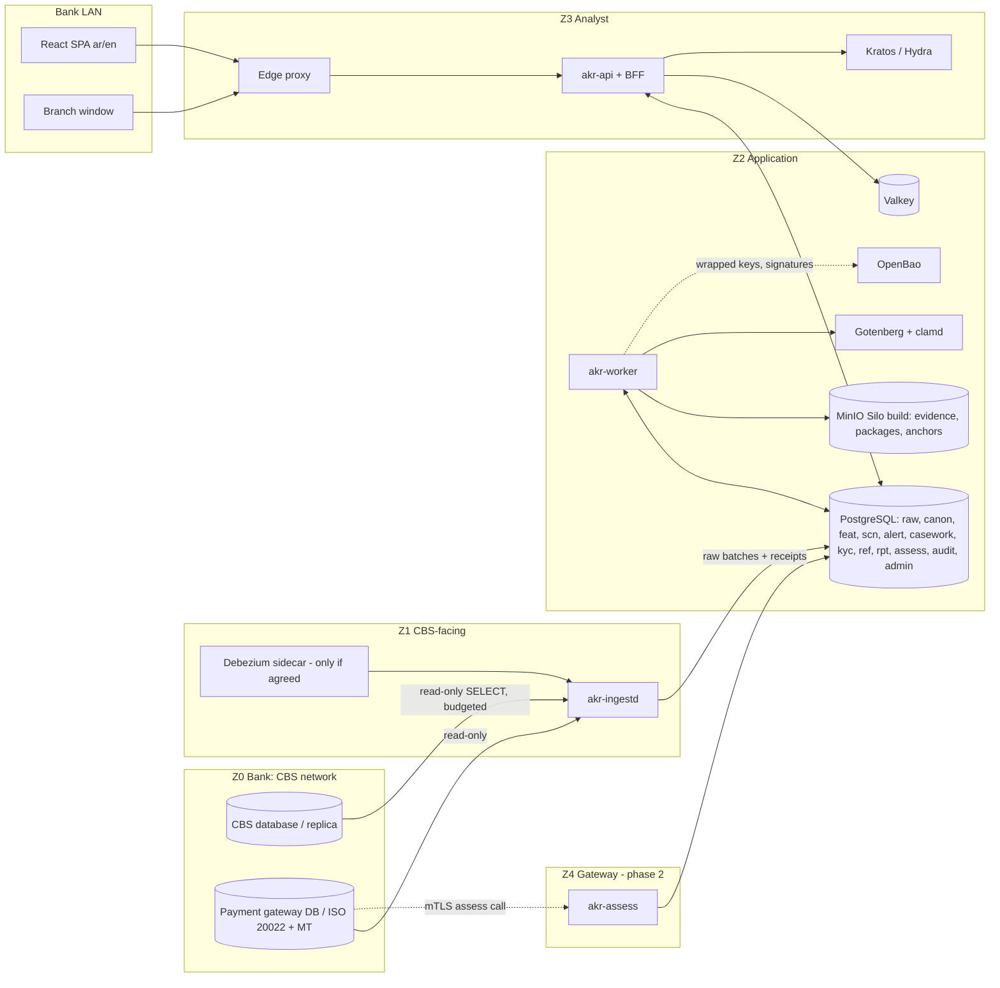

# Architecture — AKR-TMS

Status: draft for review (2026-10-07). Companion to [../tech-stack.md](../tech-stack.md). This document records the
decisions taken in the research (files 01-33, synthesis in file 33), the system design and the build phases. The
requirement IDs in brackets are the research requirements that carry each point. Open items are at the end.

---

## 1. Purpose

Give an Iraqi bank one system for its AML and KYC obligations: know and rate every customer, screen every customer
and payment party against the lists, monitor every transaction against the CBI catalogue and the bank's own risks,
investigate and decide alerts with a record that survives inspection, report to the AML/CFT Office through goAML,
and prove to the CBI, the external assessor and correspondent banks that all of it was done. The system reads the
bank's core banking system (CBS) and never writes to it. One installation per bank, on the bank's servers.

## 2. Locked Decisions

| # | Decision | Choice | Notes |
|---|---|---|---|
| D1 | Deployment | One installation per bank, single tenant, on the bank's own assets | Only content services are hosted (lists, typology packs, signed release bundles), and they carry no bank data. A hosted multi-tenant option is a later question, gated by the CBI's cloud rules (SP-89, SP-90, TS-34) |
| D2 | CBS access | Read-only database connection; never the CBS backend or its APIs | Four connection tiers CT1-CT4 (5.1); the bank's chosen read-only level is declared and proved; grants checked on every connect, fail closed on any write privilege; signed load budget and kill switch; the CBS is never queried on demand by customer or case (C-01..C-16, C-35, C-54) |
| D3 | Timing | Post-event monitoring in phase 1; pre-release checks only in phase 2 | Phase 2 adds an optional synchronous assessment API that the bank's payment gateway calls before release (C-55..C-59). Nothing in phase 1 can stop a payment |
| D4 | Service shape | Modular monolith: four binaries over shared crates | `akr-api`, `akr-worker`, `akr-ingestd`, `akr-assess`; separated for security zoning; no inter-service RPC; no message broker (TS-01, TS-02, TS-08) |
| D5 | Stack | The DBS stack with three changes | Valkey for Redis and OpenBao for Vault (licences); MinIO kept as a pinned Silo build with Chainguard as second source (owner, 2026-10-07) (TS-22, TS-23, TS-37, TS-41..TS-43) |
| D6 | Detection | Rules first; models earn their place | The CBI catalogue (173 items) is an always-on, never-pruned pack; the AKR library is an extension pack; scenarios are declarative documents compiled to SQL or CEL, no free SQL; in phase 1 a model ranks rule alerts and never suppresses one (S-01, S-04, S-51, T-13, T-14) |
| D7 | Decisions | People decide | A score alone never rejects; at most it holds. Reports, no-report decisions, restrictions and exits carry a named human decider and coded reasons. Four-eyes by Cedar `forbid` rules and a database constraint. GenAI drafts, never decides (C-65, M-19, M-20, GV-43, GV-48) |
| D8 | Case engine | No general workflow engine | A Rust case aggregate (statuses as events, property-tested) plus the DBS workflow DSL for approvals and tasks; a per-bank policy pack pinned per case (M-74, M-75, TS-20) |
| D9 | Reporting | goAML packages generated and validated here; filed by a named officer | XML validated against the Office's published XSD through a profile registry; AKR-TMS holds no goAML credentials and does not automate the portal; it records the reference. Freeze reports and replies to Office requests are official letters (owner, 2026-10-07) (RP-01, RP-38, RP-39) |
| D10 | Acting | Decide, record, instruct, verify; never execute | Freezes, holds, restrictions and exits are neutral tasks for bank operations with clocks and a verification level V0-V3 (M-32, M-33, M-34) |
| D11 | Tipping-off | Safe by construction | Sensitivity tiers with case access lists and existence masking; neutral wording on every task and notice; no AML reason ever written to the CBS; no external message channel (SP-26, SP-27, SP-31, M-65, TS-21) |
| D12 | Audit | The DBS audit trail, kept without limit | Per-partition hash chain, Merkle anchors signed by an OpenBao transit key, copies in a COMPLIANCE-locked bucket; reads of customers, cases and reports are audited (SP-39, SP-42..SP-44) |
| D13 | Records | One retention engine, strictest rule wins | Classes R1-R13 with jurisdiction profiles; Iraq floor seven years for AML data; legal holds; crypto-shredding of partitions; deletion certificates (SP-53, SP-56, SP-59, SP-60, M-05) |
| D14 | Identity | Standalone Kratos by default; OIDC upstream as an option | Mandatory MFA; step-up (AAL2, single-use) enforced locally whatever the upstream; Ory Polis optional for SAML and SCIM (SP-14, SP-15, TS-25) |
| D15 | AI | On premises only | No external AI API. Models served as ONNX inside the bank, validated and in shadow before use, kill switch to rules only. GenAI limited to an enforced list of permitted uses with a grounding verifier and a person's acceptance (T-51, TS-16, TS-17, GV-45..GV-48) |
| D16 | Languages | Arabic (default) and English; Kurdish in P3 | Right to left first; Western digits in data; Hijri dates for display and entry only (UX-18, UX-19, UX-22) |
| D17 | Jurisdiction | Iraq profile always on; foreign rules as packs | US, UK, EU and Gulf regime packs = profile, clocks, templates and an output adapter (RP-71..RP-75) |
| D18 | Updates | Signed bundles imported by the bank | No standing vendor access; nothing pushed remotely; the bank's change board approves each release (TS-30, SP-03, SP-66) |
| D19 | Servers | Profile S (compose, 2 servers) or M/L (K3s, 3 nodes); same images | A second site in either profile; manual failover on S, automated on M/L (TS-29) |
| D20 | Change governance | One maker-checker change request for every governed object | Scenarios, thresholds, mappings, code maps, fail policies, rating models, roles; studio lifecycle draft, test, replay, shadow, approval, live, monitor; every alert carries all its versions (TS-15, S-50, S-52, C-51, GV-24) |
| D21 | Capacity | Never tuned to staff capacity; unknown is never low | No parameter caps alerts; a change that lowers volume carries a reason code and below-the-line evidence; a missing value scores high or falls back with a "degraded" flag (L-16, L-18, S-39, L-10, L-43, K-04) |
| D22 | Islamic banking | Optional pack | Deal-centric model; Islamic contracts never presented as higher risk in themselves; the Sharia board sees aggregates only (I-01, I-16, I-20, I-30) |

## 3. System Overview

Outside the diagram: the AML/CFT Office's goAML portal (a named officer uploads the package AKR-TMS prepared), the
bank's SMTP relay (notices without names), the bank's SIEM (audit and security events), and content services
(lists, typology packs, release bundles) imported through the bank's own route.

### Components

| Component | Binary | Role |
|---|---|---|
| Source connectors | `akr-ingestd` | `SourceReader` adapters per engine, watermarks, load budget, kill switch, grant check on connect |
| Landing and receipts | `akr-ingestd` | Raw rows verbatim with lineage hashes; batch envelope and receipt; quarantine for rows that cannot map |
| Mapping and canonical model | `akr-worker` | Admin-managed mapping specifications compiled from a closed transform library; bi-temporal canonical entities |
| Reconciliation and coverage | `akr-worker` | Ladder from batch receipt to GL tie-out; signed daily coverage certificate; coverage ledger and exclusion register |
| Features | `akr-worker` | Windows, aggregates, peer groups, profiles; incremental and scheduled |
| Scenario engine | `akr-worker` | Scenario documents (DSL.md) run incrementally, in sweeps, in replay and in shadow |
| Screening | `akr-worker`, `akr-assess` | List ingestion, Arabic-first normalisation, in-memory index, scorer, daily whole-base screening, designation look-back |
| Risk rating and KYC | `akr-worker`, `akr-api` | Rating engine, floors, triggers, review clocks, PEP register, beneficial ownership |
| Scoring | `akr-worker` | ONNX models ranking alerts; TreeSHAP explanations; shadow and challenger |
| Alerts and cases | `akr-api`, `akr-worker` | Alert generation with evidence snapshots; case aggregate; decisions; QA |
| Reporting | `akr-worker`, `akr-api` | goAML profile registry, report builder, validation, packages, CTR daily job, letters, CBI and board reports |
| Operations tasks | `akr-api` | Neutral tasks for bank operations, clocks, verification V0-V3 |
| Governance | `akr-api` | Change requests, scenario studio, inventory, validation packs, assessor workspace |
| Audit and evidence vault | all | Hash-chained audit, anchors, WORM buckets, evidence packs, legal holds |
| Assessment API (phase 2) | `akr-assess` | Synchronous decisions for the payment gateway, fail policies, signed responses |
| Ops cockpit | `akr-api` | Queues, dead jobs, ingest lag, coverage, blind periods, backups, anchors, certificates |

## 4. Zones, Topology and Environments

Trust zones Z0-Z7, default-deny, mTLS between zones (SP-04, SP-08):

| Zone | Holds | Reached from | Reaches |
|---|---|---|---|
| Z0 CBS network | CBS database, replica, payment gateway database (bank-owned) | `akr-ingestd` only, to listener ports of bank-owned views | n/a |
| Z1 CBS-facing | `akr-ingestd`, optional Debezium sidecar | Z2 (job and health calls) | Z0 listener ports; Z2 PostgreSQL; Z2 OpenBao for reads of its own source credentials (docs/plan/research.md DR-25); nothing else |
| Z2 Application | `akr-worker`, PostgreSQL, MinIO, OpenBao, Valkey, Gotenberg, clamd | Z1, Z3 (through `akr-api` only), Z4, Z5 | Bank proxy (allow-listed list providers if approved; the Office's schema page for the goAML watcher, `akr-worker` only on `z2_egress`, off by default, DR-71), SMTP relay, SIEM collector |
| Z3 Analyst | Edge proxy, `akr-api`, Kratos, Hydra | Bank LAN on 443 | Z2 |
| Z4 Gateway | `akr-assess` | Payment hub or Swift interface by mTLS | Z2 PostgreSQL and cache |
| Z5 Management | Bank PAM or jump host, Harbor, bundle import, backup target, SIEM collector | Bank admin network | Zones, for administration only |
| Z6 DR | Standby, offsite backups, second OpenBao | Replication and backup flows | None |
| Z7 Vendor | Nothing standing | Nothing | Nothing; support sessions are opened by the bank, time-boxed, `support-readonly` |

Environments per bank: production, a staging namespace (or a second compose project on profile S) with its own small
PostgreSQL and synthetic or masked data only, and the vendor's own development and test environments, which never
hold bank data. Profiles S, M and L are in tech-stack.md.

## 5. Data from the CBS

### 5.1 Connection tiers and read-only levels

| Tier | What | When |
|---|---|---|
| CT1 Replica read | A standby or reporting clone the bank already runs | Preferred where it exists: load-free |
| CT2 View read on the primary | A read-only account reading designated views, small batches, off-peak or throttled | The default for first deployments; easiest for a DBA and the CBS vendor to approve |
| CT3 Log-based CDC | Debezium from the primary or, better, a standby | Only where the bank agrees; strict latency or very large tables |
| CT4 Bank-delivered extract | Files or a landing database written by the bank or the CBS vendor's batch | CBSs with no SQL access |

(Research file 25 calls these R1-R4; renamed here so they do not clash with retention classes R1-R13.)

Each deployment declares and proves its read-only level: **level 1 data plane** (no write reaches the CBS; always
delivered and proved), **level 2 footprint-free** (nothing created in the CBS; holds for CT1, CT2, CT4, not for CT3),
**level 3 load-free** (no load on the primary; holds on CT1, budgeted elsewhere) (C-03, C-04). Ingestion polls first,
behind a change-source interface, so a bank moves between tiers by configuration (C-01, C-06, C-39). CT1, CT2 and CT4 as
a bank landing database are available from the first release (phase 05); CT3 and CT4 file delivery arrive with
ingestion in phase 11 (DR-63).

Controls: grants are read on every connect from the session's effective privileges and every active role (not only
direct grants) and judged against an allow-list per engine, and the source refuses to start if any write, create or
ownership privilege or DBA-class role or privilege exists or a database link is usable without a bank-signed
exception (DR-40, DR-60); the credential reaches only `akr-ingestd`, from OpenBao (DR-59); discovery reads the
dictionary first and data only from objects the bank approved (DR-62); every statement is generated (from the
discovery generator, later the mapping) and parsed to prove a single bounded `SELECT` over approved objects, with no
predicate but its bound, no database link and no synonym to a remote object (DR-61), and
runs inside the engine's read-only transaction mode (on Oracle `SET TRANSACTION READ ONLY`), so the database itself
rejects a write a missed grant would allow; a signed per-bank
load budget (sessions, statement time, rows per minute, end-of-day blackout, lag ceiling) and a kill switch; a DBA who
locks the account puts the source in a normal "paused by bank" state with back-off, an open coverage gap shown to the
MLRO and automatic backfill on resume (C-13, C-15, C-16). A CBS restored to an earlier point, or a failover with lost
commits, halts the watermarks and raises an alarm (C-64).

### 5.2 Pipeline

1. `akr-ingestd` reads a batch per source table by the table's change strategy (DR-37) inside the load budget: a
   business-date range with a trailing re-read window, a key range, or a full snapshot hashed per row and diffed
   against the previous one for tables with no indexed change date. Each read is one table over a key range; joins
   are made in the AKR-TMS store (a source may have no optimizer statistics, DR-40).
2. Rows land verbatim in `raw` with lineage hashes (the one exception: columns holding card or authentication data,
   which each adapter pack's deny list drops before landing); a batch receipt records counts and control totals; the same
   transaction enqueues the mapping job (same-transaction enqueue, `jobs.md`).
3. `akr-ingestd` maps raw rows to canonical entities through the published mapping version and writes them with the
   canonical writer under `akr_ingest`, the only role with INSERT on `canon` (DR-85); `akr-worker` compiles and
   recompiles mappings but never writes canonical rows. Rows that cannot map go to the quarantine queue with a reason
   and a retry button (bulkhead: other tables continue).
4. Canonical writes enqueue feature, screening, rating and scenario work for the accounts and parties touched,
   coalesced per account within a short window.
5. The reconciliation ladder runs per batch and per day; the end-of-day gate releases end-of-day scenarios.

Loads are idempotent; monitored data are never deleted because the source deleted them, and a row that disappears
between reads becomes a delete event (DR-37). Back-dated postings are caught by the trailing re-read window (default
31 days of business date, per source) and removals outside any window by a scheduled full snapshot diff. The raw
layer is the replay log (C-23, C-24). Payments come as native ISO 20022 and MT messages with the raw message kept, preferably from the
payment-gateway database, linked to ledger postings (C-41..C-44).

### 5.3 Mapping and the canonical model

One canonical model with lineage on every row, bi-temporal entities and UUIDv7 identifiers (C-46, C-47). Mappings
are admin-managed, schema-validated documents built from a closed transform library, published by maker-checker,
with drift detection that pauses only the affected tables (C-50..C-52). A gate stops new transaction codes and
products from flowing unclassified; reference-value drift is detected (L-01..L-06). An Arabic and Kurdish
character-set round trip runs at install, and a name data-quality profile is produced per bank (C-10, N-12). A CBS
name is read from its full name fields, not a short-name field; a value that reaches the source's byte cap is flagged
as possibly truncated and kept, never rejected; Arabic letter variants (yeh and alef maksura, teh marbuta and heh,
the alef forms, Persian and Arabic kaf) are folded before matching. Data are
minimised at the source: no full card numbers, no PIN or authentication data, a card guard before landing, no PCI DSS
scope (C-36, SP-48, SP-51). Adapter packs follow market evidence: ICS BANKS on Oracle first, then iMAL, BML ICBS,
FLEXCUBE and Temenos; Finacle on demand (C-38, C-62). Column meanings are set per installation (DR-36): the same
column can hold a different identifier at another bank on the same product, so each mapping is confirmed with the
bank before it is published.

### 5.4 Completeness

A reconciliation ladder from batch receipt to row counts, control totals and general-ledger tie-out; a signed daily
coverage certificate; a data-readiness grade (A-D) per scenario; a quarantine queue instead of silent rejection; an
MLRO coverage statement (C-25..C-27, S-03, S-54, L-01, L-04, L-05).

### 5.5 Freshness and time

| Class | Use | Objective |
|---|---|---|
| F0 | Pre-release assessment (phase 2) | p95 150 ms, p99 400 ms |
| F1 | Near-real-time monitoring | Ingest p95 under 60 s, p99 under 3 min on poll tiers; p95 under 10 s on CDC; fast-path alert evaluation within 5 s of ingest, re-evaluated at the settled time |
| F2 | Intraday aggregates | Hourly |
| F3 | End of day | Within 60 minutes of the CBS end of day |
| F4 | Periodic | Calendar (monthly liaison report by the 10th, KYC queues, board packs) |
| F5 | Reference data | Lists refreshed at least every 24 hours, every 12 hours under the 2025 controls |

Scenarios evaluate at a settled time; late data recompute the affected windows and amend alerts with an explanation
(C-22, S-09). `data_as_of` appears on every screen, export and API response (C-29).

Source time (DR-39): for CBS-derived data, `data_as_of`, freshness, dormancy and look-backs use the CBS business
date (per branch where the CBS keeps one), never the AKR server clock; F1 ingest latency and F5 refresh timers stay
on wall-clock time. A source whose business date or newest posting stops moving raises a "stale source" state with
its age shown, and a branch or feed with no postings is shown as such. Where the CBS has no dated timestamp (DR-37),
late-data and window logic rest on business dates, `posted_at` stays null, and no alert claims an intra-day order
the source does not record. CBS dates without a time zone are read as Baghdad local dates. The end of day behind F3
is detected from the CBS's own processing state (the business date advances) and confirmed per bank.

## 6. Core Data Model (sketch)

Full plan in [DATA-MODEL.md](DATA-MODEL.md). Schemas and their centre of gravity:

- `raw`: landed rows per source table, batches, receipts, watermarks.
- `canon`: party (with parsed name chains), account, relationship, product, branch, transaction (partitioned by
  booking month), transaction event, payment message, card (tokenised), facility, Islamic deal.
- `feat`: windows, aggregates, peer groups, profiles.
- `scn`: scenario definitions and versions, parameters, runs, replays, shadow results, CBI catalogue register.
- `alert`: alerts with evidence snapshots and fingerprints, screening alerts (party, list entry), quarantine.
- `casework`: cases, case events, notes, decisions, watches, tasks for operations, QA samples, network snapshots.
- `kyc`: ratings and their history, factors, overrides, reviews, PEP register, ownership chains.
- `ref`: lists and entries with aliases, code maps, calendars (Gregorian and Hijri), FX rates of the CBI.
- `audit`: audit log (monthly partitions, hash chain), anchors.
- `admin`: users mirror, roles, settings, flags, change requests, inventory, policy bundles, jobs, outbox, timers.

## 7. Detection

### 7.1 Scenario engine

A scenario is a versioned JSON document validated against a JSON Schema ([DSL.md](DSL.md)): identity and lineage
(including the CBI catalogue reference), data requirements, typed parameters with bounds and per-segment overrides,
logic of one of three kinds (aggregate from a closed operator set compiled to parameterised SQL; event as a CEL
expression; profile over feature tables), and outputs (severity, reason codes in Arabic and English, suppression,
alert template). No free SQL; bound parameters only; a statement timeout and an `EXPLAIN` cost guard per run;
evaluation on the standby when one exists (S-51, TS-14).

Execution: incremental after each batch for the accounts touched; scheduled sweeps (daily, monthly) as set-based
queries; replay of a draft over as-of history with alternative parameters; shadow beside the live version with no
alerts. Every aggregable scenario aggregates across linked parties, and free-text counterparties are resolved (S-08,
S-11, T-29). Windows and baselines follow a calendar service with Hijri dates, Ramadan, Eid, Arbaeen and pay days
(S-13, T-04). A known-answer seeded suite runs daily for every CBI item, and an independent re-implementation diffs
alerts against production (S-48, S-49, GV-10).

### 7.2 Packs

- **CBI baseline pack**: a versioned register of all 173 items (86 scenarios, 87 indicators), never pruned, with a
  coverage report from item to scenario, alert, case and STR (S-01, S-02, T-02).
- **Data-readiness grade** A-D per scenario and bank names the missing field, writes the request to the CBS vendor,
  and records "not covered" with an owner and an interim route (S-03, C-48).
- **AKR library**: 161 scenarios in 18 families as an extension pack, with typology tags, a basis tag on every
  parameter and an evidence label; bank scenarios use IDs 901-999 (S-04, S-05, S-59). The public-funds family has
  restricted visibility; a front-company score opens a review, never an automatic exit (S-29, S-30).
- **Branch observation log** with the circular's eight indicator groups; hybrid alerts combine an observation with a
  pattern (S-22, S-23).
- **Islamic pack** (optional, D22) and **regime packs** (D17).
- First thresholds come from a bootstrap ladder, then replay, sampling above and below the line, champion and
  challenger runs and a go-live gate (S-40..S-47).

### 7.3 Screening

Names are stored as parsed chains with typed parts; Iraqi list formats and aliases are parsed; lexicons cover tribes,
families, compounds and titles (N-01..N-03). One Rust normalisation library serves ingestion, batch screening and the
assessment API, with a golden test file and a parity test against the browser (N-06, N-07, TS-19, TS-36). Scoring
aligns tokens one to one, needs an evidence floor, never alerts on a family or tribe name alone, and returns "needs
more data" when a query is too thin (N-25, N-26, N-29). The mother's chain, a year-only birth date with tolerance and
exact document numbers decide (N-18..N-21), except that a placeholder number
is treated as missing and a number shared by more than one customer record never decides a match alone; the match
then degrades with a flag (D21, DR-41). Matching runs on immutable in-memory snapshots; `pg_trgm` serves analyst
search only (N-49, N-53). Thresholds per list are set against an alert budget agreed with the MLRO and a recall floor,
tested on an evaluation harness and a synthetic Iraqi name corpus (N-31, N-32, N-37, N-38).

A screening alert is a (party, list entry) pair with its own queue and clocks; it becomes a case only when escalated
or confirmed (M-12). Match states use the Office's terms (true, potential, incorrect) with the CBI's terms as aliases
and a per-bank doubt policy; a potential match freezes nothing (M-24, SP-98, RP-54). Pair memory is offered only for
incorrect matches and is invalidated when either record changes; good-guy rules are separate and expire (N-35, N-36).
The whole customer base is screened daily and each list change triggers a designation look-back (C-63, L-41, S-32).
The national list comes from a feed negotiated with the Office, with the Excel export as a stop-gap and an ID
reconciliation (N-45).

### 7.4 Customer risk rating and KYC

A hybrid engine (floors, weighted factor blocks, governed overrides) with five internal levels mapped to the CBI's
High, Medium and Low (K-01, K-02); 27 starting factors in six blocks; an unknown applicable factor scores 60 and a
mandatory unknown caps the best level (K-03, K-04). Floors FL-01..FL-15 cannot be overridden per customer; triggers
TR-01..TR-26 re-rate on events (K-07, K-11). Two clocks per customer (classification review, KYC refresh) and a
light automated yearly check for everyone (K-09, K-10). Overrides: upward easily, downward only by compliance, one
level per decision, expiring within 12 months (K-24, K-25). A PEP register with tiers and kinship degrees (K-21..K-23); a
CBS PEP field is not a PEP source unless the bank declares it maintained (DR-38);
beneficial ownership by chain calculation (K-18, K-20). Ratings live in AKR-TMS; the bank applies a one-way
rating-change feed and sees a divergence view against the CBS risk field (K-35), which reports an unpopulated CBS field as not maintained instead
of listing every customer as diverging. No protected attributes or name-derived proxies as factors (K-33, GV-37).
CBS PEP, sanctions and risk-level fields that hold one default value on every customer are read as not assessed,
never as not PEP or low (D21, DR-38).

### 7.5 Models

Gradient-boosted trees with monotonic constraints, trained offline inside the bank, served as signed ONNX through
`ort`, explained by an in-house TreeSHAP. In phase 1 models rank rule alerts only. A model goes live only after shadow
running and validation, must beat a transparent baseline, and needs enough labels (gates at about 50, 200 and 500
positives); starter models are flagged "externally calibrated, temporary" (T-13..T-15, GV-05, T-63).

### 7.6 Graph

Entity links as PostgreSQL edge tables; components and ego graphs with recursive CTEs and `petgraph`; network cases
have a parent with a subgraph snapshot and one child per subject (M-10, T-21, T-22, TS-18). Kinship links are hidden
by default (T-24).

## 8. Alerts, Cases and Decisions

One vocabulary: signal, alert, internal report, authority request, RFI, case, task, decision, report, control
incident (M-06).

- Every alert carries an evidence snapshot and a stable fingerprint, and every version that produced it (scenario,
  parameters, mapping, list, model) (M-07, M-75).
- One open case per party and case family: alerts are merged, never hidden, and each keeps its contribution outcome
  for scenario statistics (M-08, M-09, L-17).
- Priority class before score: P0 list match, terrorist-financing or proliferation indicator, authority order; the
  score shows its components; age raises priority; a daily sample of low scores is reviewed (M-03, M-13, M-16).
- Statuses are events on the case aggregate; four-eyes by Cedar `forbid` and a database constraint; a
  delegated-authority matrix signed by the MLRO (M-18..M-20).
- Outcomes: no report, UTR or STR (TFR for terrorist financing), each with a named decider and coded reasons; the
  CBI's seven escalation criteria and a UTR-versus-STR aid sit in the decision panel (M-01, M-27..M-29). A no-report
  decision goes to a shelved-decision register (M-26). A UTR starts a watch (default 90 days) that ends in extend,
  close or an STR (M-35).
- Notes are immutable once posted; a closed case is sealed with a hash (M-04, M-59, M-61).
- No screen ranks individuals by speed; work in progress capped at 10 per analyst; capacity is handled by ranking,
  grouping, staffing and surge mode (M-17, M-57, M-11, M-52).
- QA samples closures with an independent reviewer and a calibration kit (M-47..M-50).
- Branch requests go to the liaison officer only; answers are stored as claims with source and corroboration (M-43,
  M-45, L-47).
- Approvals and tasks that are routing rather than case state use the DBS workflow DSL (approve, review, form,
  parallel, terminal) with timers on the bank's calendar.

## 9. Reporting to the AML/CFT Office

- **goAML profile registry**: XSD, patches, lookups, business rules, clocks and limits read from the Office's
  published XSD (5.0.2 at the time of research) and never hard-coded; a daily watcher on the Office's attachment list
  (RP-01..RP-03, RP-82).
- **Report types**: STR, SAR, TFR, UTR, CTR and AIF; freeze and match reports and replies to requests as official
  letters (RP-11, RP-12, RP-16; owner's answers in research file 23 s.9).
- **Validation**: six layers, an Iraqi business-rule catalogue (mother's name, city and state, name character rules,
  lookup codes), a quality score with the Office's four grades, and a consistency checker (RP-17, RP-27..RP-30).
- **Packages**: XML, attachments, bilingual PDF and a SHA-256 manifest. A named officer uploads; AKR-TMS records the
  reference and captures portal content before goAML purges it (RP-38, RP-39, RP-41, RP-79).
- **After filing**: rejections parsed into field findings; a "poor" grade creates a returned-for-completion task; a
  feedback register records the Office's sessions and the changes made (RP-32, RP-42, RP-43, RP-84).
- **CTR**: a daily job aggregates each customer's cash per day, tests the USD equivalent at the CBI rate of the day,
  and ties control totals to the cash general ledger (RP-50..RP-52; aggregation on by default in the Iraq profile,
  owner 2026-10-07).
- **Tax reporting**: FATCA, and CRS as an optional module switched on per bank (RP-69).
- **AI drafting** works only from the evidence snapshot, with sentence-level sources and every number recomputed
  (RP-23).
- **Early piece (P0)**: the goAML checker validates a bank's existing report files against the same registry and
  grades them, before the rest of the system is installed.

## 10. Acting Without Writing

Every action is a neutral task for bank operations with a clock; completion carries the CBS reference; AKR-TMS
verifies it from its copy of the data and stores the level reached (M-32, M-33):

| Level | Meaning |
|---|---|
| V0 | Not observable in the CBS data: a second person confirms; flagged in reports |
| V1 | Status observed |
| V2 | No debit after the effective time observed |
| V3 | Order-to-block time computed |

- **True match**: a freeze task (default 8 hours, never beyond 24 hours from the listing decision), the first report
  to the freezing Committee within 48 hours (copy to the Office) and the second at two months; AKR-TMS checks that the
  block is in place and that no debit, fees included, followed the order (M-34, RP-55, RP-56, C-63).
- **Instruction to refrain** from the Office: a 7-working-day clock with confirmation and a post-check (RP-45).
- **Release after delisting** only on a recorded decision (RP-59); unresolvable matches go to the Committee's
  technical committee as a referral (RP-58).
- **Exits** need senior approval and an individual assessment; no group exits (M-36).

## 11. Authorisation, Sensitivity Tiers and Tipping-off

Cedar, deny by default, two gates (token scope, then policy), every decision audited (SP-19, TS-26). Roles: analyst
level 1 and 2, MLRO and deputy, branch liaison officer, compliance maker, compliance checker, model-risk officer,
internal auditor, CBI or external inspector (time-boxed), platform administrator, infrastructure operator, security
officer, vendor support (nothing standing). Attributes: branch scope, customer sensitivity tier, case access list,
clearance, time window, purpose of access.

| Tier | Covers | Access |
|---|---|---|
| Normal | Ordinary customers, transactions, alerts | Branch scope; AAL2 session; logged |
| Restricted | Staff and their relatives, board and senior managers, PEPs, VIP accounts, accounts managed by a bank officer | Named roles only; logged with purpose |
| Suspicion | Any customer with a case at STR candidate or later, any filed report, any FIU, CBI or court request | Case access list; fresh step-up; existence masked from everyone else (a denied read is a 404, not a 403) |

Segregation-of-duties pairs are `forbid` rules (maker never checker; proposer never approver; analyst never QA
reviewer of their own case). Break-glass needs two approvers and lasts at most four hours (SP-21, SP-24). Tipping-off
rules: neutral wording for every task, notice and branch-window status; inference tests that fail the build when a
count, search, export or error reveals a suspicion-tier fact; no AML reason ever written to the CBS (SP-31, SP-33,
RP-62, M-65, M-69, F-16).

## 12. Audit Trail and Evidence Vault

- **Audit**: the DBS design reused. Separate from operational logs; append-only; monthly partitions with a hash chain
  per partition; Merkle anchors every five minutes signed by an OpenBao transit Ed25519 key and copied to a
  COMPLIANCE-locked bucket; reads of customers, cases, reports and exports audited; auditors' own searches logged;
  exported to the bank's SIEM; kept without limit (SP-39, SP-42..SP-44).
- **Evidence vault**: MinIO (Silo build) behind an S3 guard; evidence snapshots, attachments, report packages, coverage
  certificates and board packs; SHA-256 on write and on serve; antivirus on upload; encrypted before upload with
  OpenBao-wrapped data keys, one per object, so a locked object can be shredded by erasing its key; served by
  akr-api, never by a presigned link; COMPLIANCE object lock at the class floor (file 32 s.12; DR-44).
- **Evidence packs** per report, per case and for the assessor (mapped to the D2 tests), the CBI coverage report and a
  board pack, all generated from system facts (S-02, S-56, S-57, M-62, M-63, RP-63, RP-64, GV-35).

## 13. Identity, Sessions, Step-up

Standalone Kratos with mandatory MFA (WebAuthn preferred, TOTP minimum), Hydra as token issuer, the DBS BFF with
CSRF bound to the session. A generic OIDC upstream (Entra ID, ADFS, Keycloak) is configuration; Ory Polis is optional
for SAML and SCIM. Step-up AAL2 as a single-use ledger row, enforced locally, before: opening a suspicion-tier record,
any decision, any approval, any export. Offboarding: one action disables the identity, revokes sessions and tokens,
ends role grants and sweeps open tasks; quarterly access review signed by the security officer.

## 14. Change Governance and Model Risk

- One change request (maker, checker, reason code, evidence, effective time) for every governed object (D20).
- Scenario studio lifecycle: draft, unit test, replay on as-of history, sampling above and below the line, shadow,
  approval, live, monitoring; a change that lowers volume carries a reason code (risk or capacity) and below-the-line
  evidence (L-16, L-18, S-39).
- Inventory record before use for every rule, parameter set, model, matcher, reference list and language-model
  component, with tier, owner, validator and committee (GV-01, GV-03, GV-04); a seven-part validation pack and a
  per-bank delta validation (GV-09, GV-15); shadow for every new or changed Tier 1 or 2 object, a permanent challenger,
  and a kill switch back to rules only (GV-20, GV-24, GV-25, SP-95).
- Fairness: protected-attribute register, proxy scan, monthly outcome metrics (GV-36..GV-38).

## 15. Notifications

In-app (outbox, notification centre, SSE) and the bank's SMTP relay only. Notices never carry a customer name, a
case subject or an AML reason; they say that work is waiting and link into the system. No WhatsApp, SMS or push
channel (TS-21).

## 16. Internationalisation and Calendars

Arabic default, English second, Kurdish in P3. Every string in both languages; logical CSS properties only;
directional icons flip; Western digits in data and tables; numeric expressions isolated for bidirectional text; ICU
plurals with all six Arabic forms; Hijri dates for display and entry only, stored as Gregorian (UX-18, UX-19, UX-22,
UX-24). Business calendar per bank: Iraqi public holidays, Ramadan hours, Eid, Arbaeen, pay days; used by timers,
deadline clocks and scenario baselines.

## 17. Records and Retention

One retention engine, classes R1-R13 (research file 30 s.12.3), each table assigned a class in DATA-MODEL.md:

| Class | Holds | Iraq profile floor / default |
|---|---|---|
| R1 | Raw landing | Bank-set, 30-400 days (default 90) |
| R2 | Monitoring copy of transactions | 7 years / 10 years, by booking month |
| R3 | Master data copy (party, account, relationship, KYC profile) | 7 years after the relationship ends |
| R4 | Features and aggregates | 3 years or the longest look-back |
| R5 | Alerts and dispositions | 7 years from the report date / 10 years (sanctions-tied 10) |
| R6 | Cases and STRs | 7 years from the later of closure and report |
| R7 | Screening and sanctions records, phase-2 decisions | 7 years |
| R8 | Rating history | 7 years after the relationship ends |
| R9 | Configuration history | Outlives every alert it explains / 10 years after retirement |
| R10 | Audit trail and access events | Unlimited |
| R11 | Models and validation | 10 years |
| R12 | Operations (logs, metrics, traces, bundles, extracts) | 30-90 days |
| R13 | Backups | About 5 weeks |

High-volume classes drop partitions (with a legal-hold copy first, and the drop blocked if the copy fails);
customer-linked classes purge record by record on relationship-end clocks; crypto-shredding by partition key;
deletion certificates replayed after a restore (SP-53, SP-56, SP-59, SP-60). Opening a case freezes an evidence
snapshot, so dropping old partitions never damages a case.

## 18. Backup, DR and Blind Periods

pgBackRest with WAL archiving every minute; restic for buckets and OpenBao snapshots; an offsite copy; a monthly
rehearsed restore; a streaming replica is not a backup. AKR-TMS is registered with the bank as a regulatory-critical
system; an outage is recorded as a blind period, alerts for that period are produced when data catch up and are never
back-dated, and the blind period appears in the coverage statement (SP-83, SP-85, SP-87, TS-39). Restores replay
deletion certificates before the system reopens.

## 19. Performance and SLOs

| Path | Objective |
|---|---|
| Queue and case first content | Within 1 s at 50 concurrent analysts (UX-16) |
| Type-ahead search | p95 300 ms |
| Ingest (poll tiers) | p95 under 60 s, p99 under 3 min |
| End-of-day scenarios | Within 60 minutes of the CBS end of day |
| Assessment API (phase 2) | p95 150 ms, p99 400 ms; inline matching under 25 ms p99 |
| Lists | Refreshed at least every 12 hours |

SLOs live as code next to the alerts that watch them (TS-27, TS-28); response budgets are tested in CI.

## 20. Security Controls Summary

Default-deny zones and mTLS; MFA for every user and step-up for sensitive actions; Cedar deny by default with
existence masking; key hierarchy in OpenBao (Shamir or auto-unseal, transit KEK, DEKs per table family cached in
process, HMAC match keys, Ed25519 signing keys); field-level encryption of personal data; data minimisation at the
source; no standing vendor access and redacted support bundles; signed updates with SBOMs; ISO/IEC 27001 before the
first bank; an independent penetration test before delivery and yearly (SP-03, SP-09, SP-11, SP-64, SP-65, SP-66,
SP-74, SP-78).

## 21. Phase 2: Assessment API

`akr-assess` in zone Z4: a synchronous endpoint for the payment gateway with mTLS, signed decisions and byte-exact
replay (C-55, T-43). It reads the local list index and pre-computed features, never the CBS. Fail-open or fail-closed
is bank data per rail, corridor, currency and amount; each rail goes live through shadow and advisory modes (C-56,
C-57). A score produces at most a hold; a reject without a person only for deterministic, bank-configured prohibited
conditions; the API returns decisions and reason codes, never scores (C-65, SP-93). A release-without-decision
control, a local fallback screen beside the gateway, and recorded blind periods (C-58, C-59). Tier 1 governance by
default (GV-53). OpenBao restarts sealed, so the assessment nodes use auto-unseal (second OpenBao or the bank's HSM)
and keep signing and data keys cached in memory.

## 22. Build Phases

Macro-phases follow the leadership plan (section 11); task lists and exit criteria are in [ROADMAP.md](ROADMAP.md);
implementation phases in [plan/roadmap.md](plan/roadmap.md).

| Macro | Name | Content |
|---|---|---|
| P0 | Discovery and foundations | Platform foundation, identity, audit, authorisation; discovery tooling (schema and data profiling, CBI coverage gap report, data-readiness grades); the goAML checker. The two early pieces ship inside the CBI reform window (owner, 2026-10-07) |
| P1 | Core system, first bank | Ingestion and canonical model, reconciliation, screening, risk rating and KYC, scenario engine with the CBI pack and Iraq library, alerts and cases, network view, goAML reporting, operations tasks, command centre, branch window, evidence vault; ends with a two-to-three-month parallel run |
| P2 | Before release, and smarter | Assessment API, models in shadow then live, the assistant for summaries and narratives, correspondent and validator packs |
| P3 | Scale | Further banks (3-5 months each), more regime packs, Islamic pack updates, Kurdish interface |

## 23. Open Items

- AML/CFT Office: the meaning of the Iraqi code-table additions (Q10), the report-date element the server expects,
  the list of rejection messages and how long the portal keeps filed reports, whether a TFR follows a true match;
  the national list feed (bulk or API key). For the pilot letter (research file 23 s.9).
- Counsel: the AGPL reading for the MinIO code line and the optional Grafana family; the vendor legal screen.
- First CBS adapter: confirm ICS BANKS on Oracle with the first bank and its release; the bank's read-only tier and
  level; whether AKR-TMS reads the live database, a replica or a test copy (the discovery snapshot was 22 months
  behind its clock); who maintains PEP, risk and expected-activity data, since the CBS fields were empty (DR-38).
- Hardware sizing from discovery data; a load test on the target hardware.
- Patroni + pgBackRest versus CloudNativePG (profile M/L).
- Chart and graph libraries in RTL (spike).
- Arabic screen-reader behaviour (unverified, research file 31).
- Whether the shared platform crates are later extracted into a private crate registry shared with the DBS.
