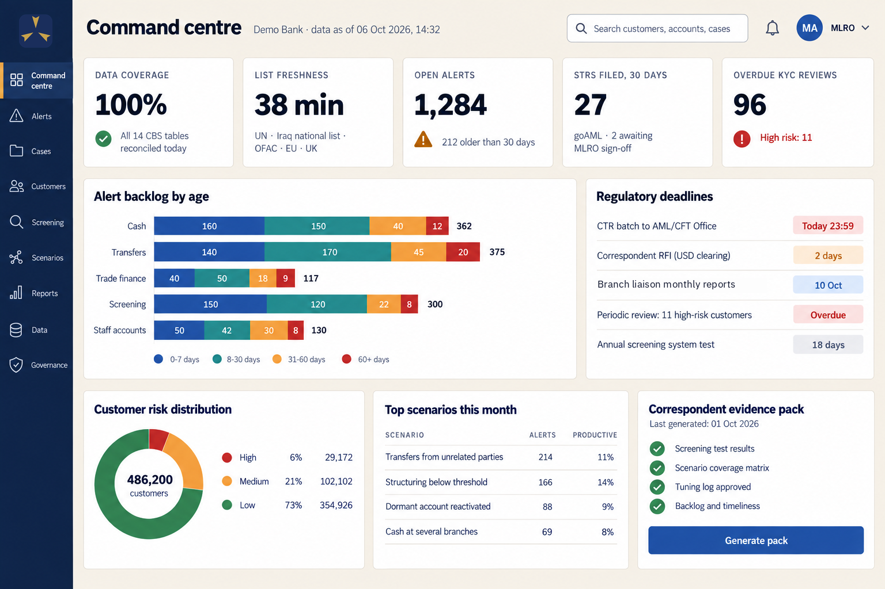
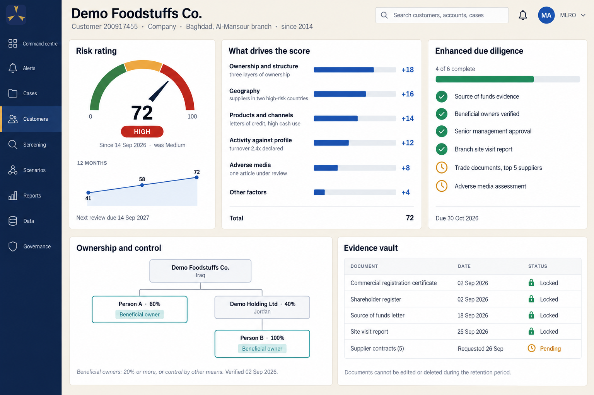
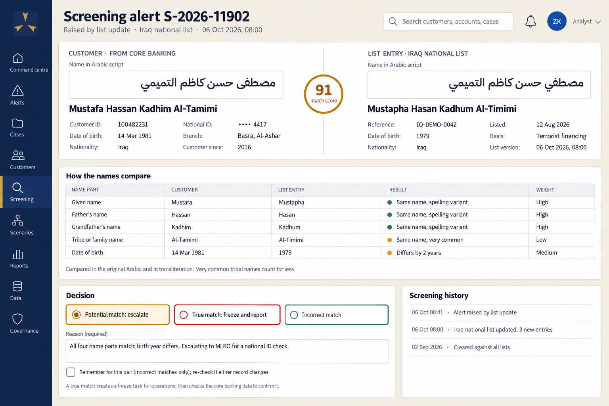
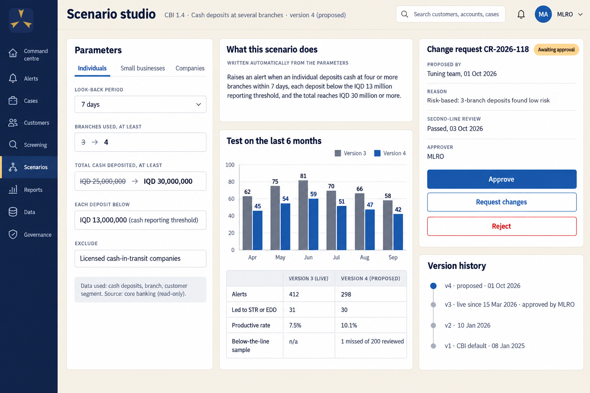
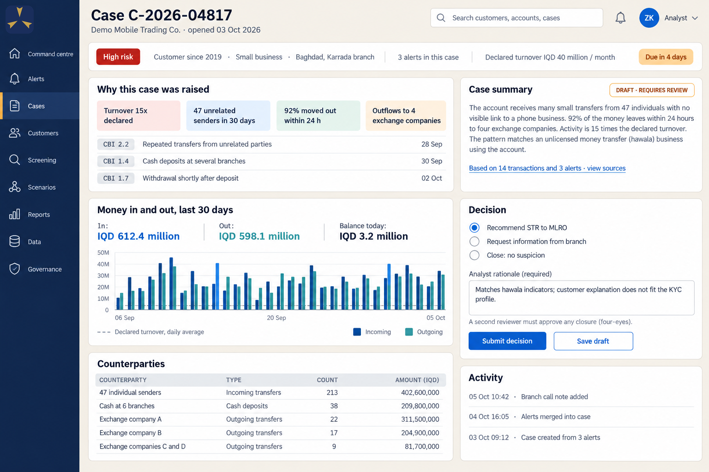
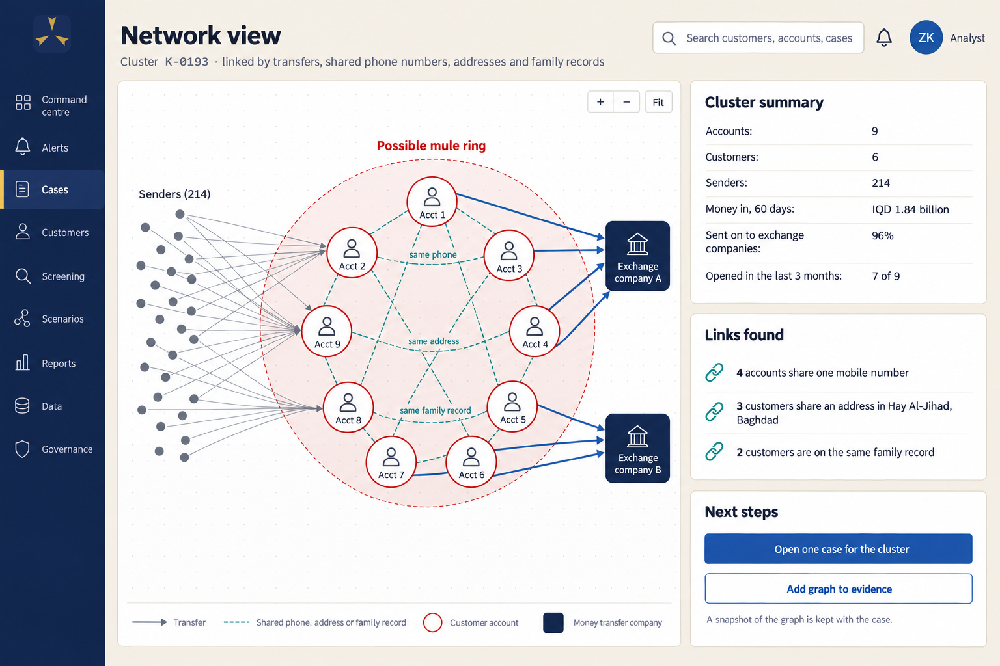
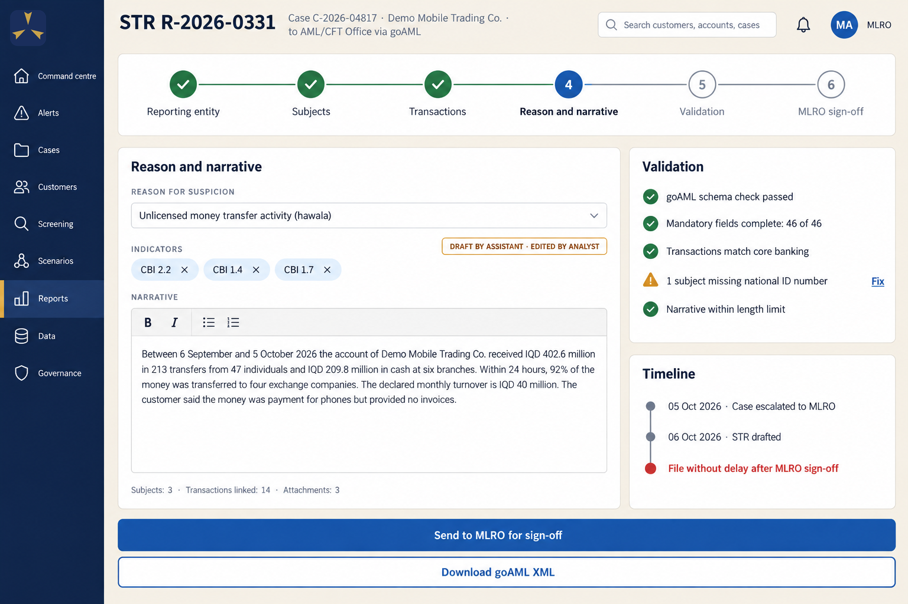
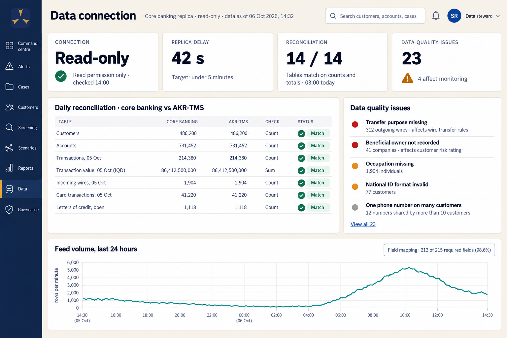

<!-- AKR-TMS plan, Arabic edition: source text for AKR-TMS-plan-ar.pdf. Same structure as plan.md (divs, ids, classes,
     markdown="1" on every div that holds Markdown). Build with: python3 build.py ar. Figures use Western digits (0-9)
     by choice; the mockups show the English interface, as in the English plan. -->

<section class="cover">

<b>AKR</b>-TMS

نظام مراقبة المعاملات ومخاطر العملاء

<h1>نظام لمكافحة غسل الأموال ومعرفة العملاء <em>مصمَّم للمصارف العراقية</em></h1>

خطة لمراقبة المعاملات والفحص على قوائم العقوبات وتقييم مخاطر العملاء، تستوفي تعليمات البنك المركزي العراقي، وتقدّم للمصارف المراسلة الأجنبية الأدلة التي تطلبها، ولا تمسّ النظام المصرفي الشامل.

إلى قيادات المصارف ومديري الامتثالتشرين الأول 2026

</section>

## 1. الملخص {#summary}

19 حزيران 2026

عودة العراق إلى القائمة الرمادية لمجموعة العمل المالي، مع خطة عمل من ثمانية بنود

32 مصرفاً

في قوائم البنك المركزي العراقي لشهر شباط 2026: 28 ممنوعة من التعامل بالدولار، و4 في القائمة السوداء

نحو 6

تقارير عن معاملات مشبوهة لكل مصرف في السنة (2024)

86+

سيناريو للبنك المركزي يجب على كل مصرف تشغيلها حداً أدنى (ضوابط 2025)

باتت المصارف العراقية مطالَبة اليوم بأن تُثبت فاعلية ضوابطها لمكافحة غسل الأموال أمام جهات من خارجها:
البنك المركزي العراقي، ومقيّمي مجموعة العمل المالي، وقبل كل شيء المصارف المراسلة الأجنبية التي تقرّر إن كان المصرف
العراقي يستطيع تحريك الدولار أصلاً. لم يعد امتلاك نظام للمراقبة كافياً؛ فعلى النظام أن يكتشف ما يهمّ فعلاً في
البيانات العراقية، وأن يُثبت أنه فعل ذلك.

نظام AKR-TMS مصمَّم للمصارف العراقية لمكافحة غسل الأموال (AML) وتطبيق مبدأ «اعرف عميلك» (KYC). فهو يراقب المعاملات،
ويفحص العملاء والمدفوعات على قوائم العقوبات، ويقيّم مخاطر العملاء ويدير مراجعات «اعرف عميلك»، ويدعم التحقيقات،
ويُعِدّ التقارير لنظام goAML لدى مكتب مكافحة غسل الأموال وتمويل الإرهاب، ويحفظ الدليل على كل خطوة. ويقرأ قاعدة
بيانات النظام المصرفي الشامل للمصرف عبر اتصال للقراءة فقط، ولا يغيّر فيها شيئاً أبداً.

ما الذي يميّزه:

- **مصنوع للعراق.** دليل سيناريوهات البنك المركزي العراقي كاملاً، والقائمة الوطنية العراقية، ومطابقة الأسماء
  العربية، كلها مدمجة في أساس النظام، لا إضافاتٍ على منتج غربي.
- **للقراءة فقط، ومع ذلك شامل.** لا كتابة إطلاقاً في النظام المصرفي الشامل، ومطابقة يومية تُثبت أن كل سجل قد وصل
  وفُحص.
- **الأدلة جاهزة دائماً.** حزم الأدلة للبنك المركزي والمصارف المراسلة والمدققين المستقلين ومجلس الإدارة تُستخرج من
  البيانات الحية في دقائق.
- **قابل للتفسير، والقرار للإنسان.** لكلٍّ من القواعد والنماذج والمساعد الذكي ضوابطه الخاصة، وكل قرار يتخذه شخص
  محدد بالاسم.
- **منتج واحد لكل المصارف العراقية.** التقليدية والإسلامية، الخاصة والحكومية، مع حزم للأنظمة الأجنبية التي تطبّقها
  المصارف المراسلة لكل مصرف.

تُنفَّذ الخطة على مراحل: من ستة إلى ثمانية أسابيع للاستكشاف ومواءمة البيانات، ثم تشغيل النظام الأساسي في المصرف
الأول خلال نحو تسعة أشهر بعد فترة تشغيل موازٍ إلى جانب نظامه الحالي، ثم فحص المدفوعات قبل إطلاقها ونماذج تعلّم آلي
مُتحقَّق منها خلال الأشهر الستة التالية. ويُربط كل مصرف إضافي خلال ثلاثة إلى خمسة أشهر.

## 2. لماذا الآن: الوضع الذي تواجهه المصارف العراقية {#why-now}

### العودة إلى القائمة الرمادية

في 19 حزيران 2026 أعادت مجموعة العمل المالي (FATF) العراقَ إلى قائمة الولايات القضائية الخاضعة للمتابعة المتزايدة،
أي «القائمة الرمادية» التي خرج منها عام 2018. وتتضمن خطة العمل المطلوبة من العراق ثمانية بنود، أربعة منها تقع
مباشرة على أنظمة المراقبة في المصارف العراقية:

- زيادة تقارير المعاملات المشبوهة وتحسين جودتها؛
- كشف نشاط التحويل غير الرسمي للأموال (الحوالة) الذي يمرّ عبر الحسابات المصرفية؛
- تشديد الرقابة على المالكين والمسيطرين الحقيقيين على الشركات؛
- منع التهرّب من العقوبات المفروضة لمنع انتشار التسلح.

### الوصول إلى الدولار بات رهناً بضوابط كل مصرف

تُودَع عائدات النفط العراقي لدى بنك الاحتياطي الفيدرالي في نيويورك، ولذلك تملك الولايات المتحدة قرار حصول المصارف
العراقية على الدولار وتحريكه. ومنذ عام 2023 قُطعت المصارف العراقية عن التعامل بالدولار على دفعات: 14 مصرفاً في تموز
2023، و8 في كانون الثاني 2024، و5 أخرى أُفيد عنها في شباط 2025. وفي عام 2024 ذهبت وزارة الخزانة الأمريكية أبعد من
ذلك، فصنّفت أحد المصارف العراقية «مصدر قلق رئيسياً في غسل الأموال»، وهو تصنيف يُغلق النظام المالي الأمريكي أمامه
كلياً. أما قوائم البنك المركزي العراقي نفسه الصادرة في شباط 2026 فتسمّي 28 مصرفاً لا يجوز لها التعامل بالدولار
بشكل مباشر أو غير مباشر، و4 مصارف في القائمة السوداء.

وطريق العودة يمرّ اليوم عبر الامتثال. ففي تموز 2026 أعلن البنك المركزي العراقي تفاهماً مع وزارة الخزانة الأمريكية:
المصارف التي تستوفي معاييره في الامتثال والحوكمة وتُكمل المرحلة الأولى من برنامج الإصلاح وإعادة الترخيص تعود أولاً
إلى علاقات المراسلة المصرفية بعملات أخرى، ثم تستعيد التعامل بالدولار لاحقاً. وقد تأهّلت سبعة مصارف للخطوة الأولى.
والمصرف الذي يريد أن يسلك هذا الطريق عليه أن يُثبت أن ضوابطه تعمل.

وفي نهاية عام 2024 أغلق البنك المركزي العراقي المنصة الإلكترونية التي كان يدقّق من خلالها التحويلات بالدولار. ومنذ
ذلك الحين يتعامل كل مصرف مباشرة مع مصارفه المراسلة الأجنبية في الأردن والإمارات والكويت وأوروبا والولايات المتحدة.
ويطبّق كل مصرف مراسل قواعد بلده على عملائه العراقيين، ويستطيع أيٌّ منها إنهاء العلاقة.

| التاريخ | ما حدث |
|---|---|
| تموز 2023 | الولايات المتحدة تمنع 14 مصرفاً عراقياً من التعامل بالدولار |
| كانون الثاني 2024 | منع 8 مصارف أخرى بسبب مخاوف تتعلق بالعقوبات على إيران |
| تموز 2024 | قاعدة نهائية من وزارة الخزانة الأمريكية بحق مصرف عراقي بوصفه «مصدر قلق رئيسياً في غسل الأموال» |
| نهاية 2024 | إغلاق منصة الدولار في البنك المركزي؛ المصارف تتعامل مع مراسليها مباشرة |
| كانون الثاني 2025 | البنك المركزي يصدر ضوابط رقابية مفصّلة لمكافحة غسل الأموال تتضمن متطلبات صريحة للأنظمة |
| شباط 2025 | منع 5 مصارف أخرى، أغلبها مصارف إسلامية |
| أيلول 2025 | إعادة فرض عقوبات الأمم المتحدة على إيران؛ الولايات المتحدة تصنّف أربع جماعات مسلحة عراقية أخرى منظماتٍ إرهابية |
| شباط 2026 | البنك المركزي يُدرج 28 مصرفاً ممنوعاً من التعامل بالدولار و4 في القائمة السوداء |
| حزيران 2026 | مجموعة العمل المالي تُدرج العراق في القائمة الرمادية |
| تموز 2026 | البنك المركزي ووزارة الخزانة الأمريكية يتفقان على طريق عودة للمصارف التي تجتاز برنامج الإصلاح |
| آب 2026 | تعاميم البنك المركزي بشأن المؤشرات السلوكية والأشخاص المعرضين سياسياً |
| أيلول 2026 | الموعد النهائي لتقديم التقييم الخارجي لضوابط مكافحة غسل الأموال لكل مصرف خاص ضمن برنامج الإصلاح |
| تموز 2027 | سريان لائحة الاتحاد الأوروبي الجديدة لمكافحة غسل الأموال على كل مصرف مراسل أوروبي |

### رفع السقف محلياً

جاءت الضوابط الرقابية التي أصدرها البنك المركزي العراقي في كانون الثاني 2025 محدّدةً على نحو غير مألوف في ما يجب على
نظام مكافحة غسل الأموال أن يفعله. فهي تشترط متابعة آنية وفورية لحركة الحسابات مقارنةً بما صرّح به العميل؛ وتشغيل
دليل سيناريوهات البنك المركزي، الذي يضم أكثر من 86 سيناريو، حداً أدنى؛ واستخدام الذكاء الاصطناعي والتعلّم الآلي في
كشف النشاط المشبوه؛ وإيقاف المعاملة المطابقة لأحد السيناريوهات إلى أن يجيزها مسؤول الإبلاغ عن غسل الأموال (MLRO)؛
والفحص على قوائم الأمم المتحدة والعراق والولايات المتحدة والاتحاد الأوروبي والمملكة المتحدة، مع تحديثها كل 12 ساعة
في أقل تقدير، والبحث بالعربية والإنجليزية؛ وموظف ارتباط في كل فرع له نافذة على النظام؛ وأن تتحقق من أدوات مكافحة
غسل الأموال شركةٌ معتمدة من البنك المركزي. ثم أضافت تعاميم آب 2026 فحصاً يومياً للأخبار المتعلقة بالأشخاص المعرضين
سياسياً وأقاربهم حتى الدرجة الثانية.

ويجعل برنامج الإصلاح المصرفي الذي يطبّقه البنك المركزي منذ أيلول 2025 هذا التحقق اختبارَ بقاء. فكل مصرف خاص اختار
الاستمرار كان عليه أن يقدّم، في موعد أقصاه 30 أيلول 2026، تقييماً لضوابطه في مكافحة غسل الأموال يُعدّه مدقق خارجي
مستقل معتمد من البنك المركزي. ويجب معالجة الثغرات وإعادة تقديم الملف خلال ستة أشهر، وقد يُحال المصرف العاجز عن
معالجتها إلى مسار الدمج أو التصفية. والمدقق يختبر النظام نفسه: منطق قواعده وحدود التنبيه فيه، وصلاحيات المستخدمين،
وسلامة سجل التدقيق، والربط بين إجراءات العناية الواجبة والمراقبة والفحص، وإمكانية تتبّع البيانات التي يستند إليها
كل تقرير.

### الفجوة في التطبيق

خلص تقرير التقييم المتبادل للعراق لعام 2024 إلى أن معظم القواعد قائمة، لكنها لا تعمل بعدُ بالكفاءة المطلوبة: فقد
صنّف فاعلية التدابير الوقائية في المصارف بأنها «متوسطة»، وفاعلية العقوبات المتعلقة بانتشار التسلح بأنها «منخفضة».
ويشغّل كل مصرف عراقي بالفعل نظام مراقبة آلياً بسيناريوهات البنك المركزي المعيارية، ومع ذلك لم يكتب أيٌّ من المصارف
التي قوبلت سيناريو واحداً خاصاً به، وكانت أعداد كبيرة من التنبيهات تُؤرشف يومياً مقابل عدد ضئيل جداً من التقارير.
وارتفعت تقارير المصارف إلى مكتب مكافحة غسل الأموال وتمويل الإرهاب من 82 تقريراً عام 2022 إلى 672 عام 2023، ثم 451
عام 2024؛ أي ما يقارب ستة تقارير لكل مصرف في السنة. الجودة متوفرة (فقد صنّف المكتب 90% من تقارير المصارف «جيدة» عام
2022)، أما الحجم والتغطية والأدلة فليست كذلك.

### المصارف المراسلة رقيبٌ ثانٍ

كل نظام رقابي أجنبي يصل إلى المصرف العراقي عبر مصارفه المراسلة:

| | ما يعنيه للمصرف العراقي |
|---|---|
| **الولايات المتحدة** | تسوية المدفوعات بالدولار مرهونة بالفحص على قوائم العقوبات الأمريكية، بما فيها الشركات التي يملك أشخاص مدرجون 50% منها أو أكثر، وبتغطية الأنماط المرتبطة بإيران والجماعات المسلحة. ويجب الاحتفاظ بسجلات العقوبات 10 سنوات |
| **الاتحاد الأوروبي** | اعتباراً من تموز 2027 يطبّق كل مصرف أوروبي لائحة موحّدة تشترط توثيق كل تقييم، ومشاركة الإنسان في القرارات المؤتمتة، والرد على السلطات خلال أيام. ويحق لهيئة أوروبية جديدة أن تحدّد بالاسم مصرفاً بعينه من خارج الاتحاد تقصر ضوابطه، فيتعيّن عندئذ على المصارف الأوروبية وقف الأعمال الجديدة معه وإنهاء العلاقات القائمة ما لم تُثبت أن المخاطر مغطاة |
| **المملكة المتحدة** | يُصنَّف العراق بلداً عالي المخاطر. ولم تعد المصارف البريطانية ملزمة بتطبيق العناية المعززة على كل علاقة عراقية تلقائياً، فصارت جودة ضوابط المصرف العراقي نفسه هي التي تحدّد طريقة التعامل معه |
| **الإمارات والخليج** | تتبع المصارف الإماراتية إرشادات مفصّلة للمراقبة والفحص (إعادة فحص يومية، واختبار للبيانات، وضبط موثّق للإعدادات)، وتتوقع الشيء نفسه من شركائها. والكويت ولبنان مدرجتان في القائمة الرمادية أيضاً، فتنقل مصارفهما الضغط إلى غيرها |

القاسم المشترك هو الدليل. فالمصرف المراسل لا يستطيع زيارة المصرف، ولا يقرأ العربية، ولن يكتفي بكلامه. إنه يريد أن
يرى القوائم التي يجري الفحص عليها وسرعة تحديثها، والسيناريوهات التي تعمل وكيف اختُبرت، وعدد التنبيهات المنتظرة
ومدة انتظارها، ومن وافق على كل تغيير.

**ما الذي يعنيه ذلك.** لم يعد نظام مكافحة غسل الأموال في المصرف العراقي أداةً للعمليات الخلفية؛ بل صار يقرّر إن كان
المصرف قادراً على التعامل بالدولار. وعليه أن يحقق ثلاثة أمور معاً: أن يستوفي متطلبات البنك المركزي الصريحة؛ وأن
يكتشف ما يهمّ في البيانات العراقية، ومعظمها بالعربية؛ وأن يُثبت ذلك كله لجهات من خارج المصرف.

## 3. ما تشترطه القواعد، وكيف تلتقي {#rules .nobreak}

### العراق أولاً

القانون العراقي وتعليمات البنك المركزي تأتي أولاً دائماً. وقد قرأ البحث الذي تستند إليه هذه الخطة النصوص الكاملة
لقانون مكافحة غسل الأموال وتمويل الإرهاب رقم (39) لسنة 2015، وتعليمات العناية الواجبة لعام 2023، والضوابط الرقابية
للبنك المركزي لعام 2025، وتعاميم البنك المركزي الصادرة في آب 2026. وفي ما يلي خلاصة ما تشترطه من نظام مكافحة غسل
الأموال:

| المجال | ما يشترطه البنك المركزي العراقي |
|---|---|
| المراقبة | متابعة آنية لكل حركات الحسابات مقارنةً بالنشاط المصرَّح به؛ دليل سيناريوهات البنك المركزي كاملاً حداً أدنى، إضافة إلى سيناريوهات المصرف الخاصة؛ تحليلات بالذكاء الاصطناعي والتعلّم الآلي |
| إيقاف المعاملات | تُوقف المعاملة المطابقة لسيناريو إلى أن يجيزها مسؤول الإبلاغ |
| مخاطر العملاء | تصنيف مرتفع ومتوسط ومنخفض (حتى خمسة مستويات) بحسب العميل والمنتج والقناة والمنطقة الجغرافية؛ إعادة التصنيف عند وقوع الأحداث؛ مراجعة كل سنتين في الأقل؛ تحديث بيانات «اعرف عميلك» سنوياً في الأقل |
| الفحص على القوائم | قوائم الأمم المتحدة، والقائمة الوطنية العراقية، والقوائم الأمريكية والأوروبية والبريطانية، مع تسمية World-Check مصدراً للبيانات؛ كل الأطراف بمن فيهم المستفيدون الحقيقيون؛ التحديث كل 12 ساعة في الأقل؛ البحث بالعربية والإنجليزية |
| الأشخاص المعرضون سياسياً | الأقارب حتى الدرجة الثانية والمقرّبون؛ فحص يومي للأخبار المحلية والإقليمية؛ يبقى التصنيف قائماً بعد ترك المنصب |
| الحوالات | بيانات كاملة للمحوِّل والمستفيد بما فيها الغرض؛ كشف الحوالات الواردة الناقصة ورفضها إن لم تُستكمل |
| الفروع | موظف ارتباط في كل فرع له نافذة خاصة بالفرع في نظام مكافحة غسل الأموال؛ تقرير شهري في موعد أقصاه العاشر من الشهر |
| الإبلاغ | تقارير المعاملات المشبوهة عبر goAML، بما فيها المعاملات التي جرت محاولتها وأي مبلغ كان، مع ذكر الأسباب؛ قرارات مكتوبة، حتى حين يقرّر مسؤول الإبلاغ عدم الإبلاغ |
| السجلات | خمس سنوات في الأقل بعد انتهاء العلاقة، وسبع سنوات لبيانات مكافحة غسل الأموال في التقييم الخارجي لبرنامج الإصلاح المصرفي؛ إمكانية إعادة بناء المعاملات؛ نسخ احتياطية خارج الموقع |
| التحقق والضمان | تحقق شركة معتمدة من البنك المركزي من أدوات مكافحة غسل الأموال؛ خطوط الدفاع الثلاثة؛ تقارير إلى مجلس الإدارة ولجنة التدقيق |

### المعايير الدولية

تضع توصيات مجموعة العمل المالي الأربعون (بصيغتها المعدّلة حتى تشرين الأول 2025) الأساس العالمي: العناية الواجبة
تجاه العملاء، والمستفيد الحقيقي، والأشخاص المعرضون سياسياً، وشفافية المدفوعات، والإبلاغ عن المعاملات المشبوهة،
وتجميد أموال الإرهاب وانتشار التسلح «دون تأخير»، وهو ما تحدده المجموعة بساعات. وتسري القائمة الموحدة لمجلس الأمن
الدولي، بما فيها العقوبات على إيران التي أُعيد فرضها في أيلول 2025، على كل مصرف عراقي. وتضيف لجنة بازل، ومجموعة
ولفسبرغ (Wolfsberg) للمصارف العالمية، ومجموعة إيغمونت (Egmont) لوحدات المعلومات المالية، إرشادات مفصّلة في المراقبة
والفحص والإبلاغ تتخذها المصارف المراسلة قائمةَ تحقق.

### القواعد الأجنبية تلتقي على مواصفة واحدة

كُتبت القواعد الأمريكية والأوروبية والبريطانية والإماراتية كلٌّ على حدة وبفارق سنوات، لكنها تصف اليوم نظام فحص
ومراقبة متطابقاً تقريباً: قوائم كاملة ومحدّثة يُتحقق منها مقابل المصدر الرسمي؛ وفحص كل طرف وكل معرِّف، بالحروف
الأصلية وبالكتابة اللاتينية؛ ومراعاة الملكية والسيطرة؛ واختبار المطابقة قبل كل تغيير وبعده؛ وإعادة الفحص عند كل
تغيير في القوائم؛ وإبقاء التراكم تحت السيطرة؛ وتوثيق كل قرار وقابليته للتفسير. وقد بُني AKR-TMS على مجموع هذه
القواعد، ليُرضي نظامٌ واحد البنكَ المركزي وكل المصارف المراسلة معاً، ويفعّل كل مصرف «حزم الأنظمة الأجنبية» التي
تنطبق عليه.

**البحث الذي تستند إليه هذه الخطة** راجع القانون العراقي وتعليمات البنك المركزي، ومعايير مجموعة العمل المالي،
وعقوبات الأمم المتحدة، وإرشادات بازل وولفسبرغ وإيغمونت، والأنظمة الأمريكية والأوروبية والبريطانية والخليجية، وأكثر
من 50 مورّداً لأنظمة مكافحة غسل الأموال و«اعرف عميلك»، ونحو 40 قضية إنفاذ. وخرج بأكثر من 1,200 متطلب محدد للمنتج،
كلٌّ منها موثّق بمصدره.

## 4. ما يقدّمه السوق، وأين يقصر {#market .nobreak}

روجع أكثر من 50 مورّداً لأنظمة مكافحة غسل الأموال و«اعرف عميلك»، من الحزم العالمية ومورّدي الأنظمة
المصرفية الشاملة إلى الشركات الناشئة في الذكاء الاصطناعي هذا العام والمورّدين الإقليميين العاملين في العراق. يُحسن
أفضلهم أموراً كثيرة، ويتبنّاها AKR-TMS حداً أدنى له. لكن أحداً منهم لا يوثّق كل ما يحتاج إليه المصرف العراقي.

| نوع المورّد | أمثلة | نقاط القوة | نقاط الضعف بالنسبة للمصرف العراقي |
|---|---|---|---|
| الحزم العالمية لمكافحة غسل الأموال | Oracle، SAS، NICE Actimize، SymphonyAI | الشمول، ومكتبات القواعد، وإدارة الحالات | الكلفة، وتحميل البيانات الثقيل، وثغرات في دعم العربية وفي goAML |
| المتخصصون في الكشف بالذكاء الاصطناعي | Quantexa، Hawk، Feedzai، Tookitaki | تحليل الشبكات؛ نماذج ترتّب التنبيهات | غالباً سحابة أجنبية أو منصات بيانات ضخمة؛ لا دعم للعربية |
| أتمتة التحقيق | Silent Eight، Napier، Lucinity، Unit21، Flagright | مراجعة أسرع للتنبيهات؛ أدوات حديثة لإدارة الحالات | غالباً سحابية؛ استقلالية آلية تتجاوز ما تسمح به القواعد العراقية |
| محركات الفحص وبيانات القوائم | LexisNexis، Eastnets، FinScan، Swift، LSEG World-Check، Dow Jones | قوائم العقوبات والأشخاص المعرضين سياسياً؛ فحص المدفوعات | ضعف في معالجة الأسماء العربية والعراقية؛ ولا ينشر أي مورّد بيانات تغطيته للعراق |
| منصات «اعرف عميلك» وفتح الحسابات | Fenergo، Pega، Moody's، Encompass، Uqudo | سير عمل دورة حياة العميل؛ التحقق من الهوية | سحابية فقط، ومصممة لامتلاك سجل العميل مع صلاحية الكتابة؛ وواحدة فقط توثّق البطاقة الوطنية العراقية |
| وحدات مكافحة غسل الأموال لدى مورّدي الأنظمة المصرفية الشاملة | Temenos، Azentio (iMAL)، Capital Banking Solutions، Oracle (FLEXCUBE) | ربط جاهز بنظامها المصرفي؛ عقد واحد | بيانات نهاية اليوم فقط؛ لا مطابقة عربية منشورة ولا حزمة كاملة لسيناريوهات البنك المركزي. والنظام المصرفي الذي تشغّله معظم المصارف العراقية لا يتضمن وحدة لمكافحة غسل الأموال |
| المورّدون الإقليميون | Pio-Tech (الأردن)، Eastnets (الإمارات) | عملاء في العراق والمنطقة؛ وحدات goAML ومخاطر العملاء؛ فرق ناطقة بالعربية | لا دقة منشورة ولا أسعار؛ وعمق الكشف غير واضح |

**ما تشغّله المصارف العراقية اليوم.** يشغّل كل مصرف عراقي نظام مراقبة بالفعل (القسم 2)، ولذلك يحلّ AKR-TMS محلّ أداة
قائمة أو يعمل إلى جانبها، لا أنه يسدّ فراغاً. وتذكر التقارير السنوية للمصارف أدواتها، وكثيراً ما تكون عدة أدوات في
المصرف الواحد: نظام FICO Siron للمراقبة في اثنين من أكبر المصارف الخاصة، ونظام Firco لفحص المدفوعات في مصرفين،
ووحدات مكافحة غسل الأموال لدى مورّدي الأنظمة المصرفية الشاملة في أربعة مصارف، ووحدات goAML ومخاطر العملاء
والسيناريوهات من Pio-Tech، وهو مورّد أردني يذكر 29 مصرفاً في العراق ضمن مراجعه. ولا يوجد لأيٍّ من أكبر الحزم
العالمية عميل في العراق. وما زال المدققون في مصرفين يصفون الحد الأدنى الذي يشترطه البنك المركزي بأنه 25 سيناريو،
في حين يرقّم دليل 2025 ستة وثمانين سيناريو.

### ما تُحسنه أفضل الأنظمة

- **القواعد والنماذج معاً.** تغطي القواعد الأنماط المعروفة والواجبات القانونية، وترتّب النماذج التنبيهات وترصد
  السلوك غير المعتاد، ويُظهر كل تنبيه أسبابه.
- **مجموعات الأقران وحدود مُختبَرة.** يُقارَن العملاء بعملاء مشابهين لهم، وتُضبط الحدود لكل مجموعة، وتُراجَع عينة
  مما يقع تحت الحد بقليل.
- **العميل لا المعاملة.** تُجمع التنبيهات لكل عميل ولكل شبكة، فيحقق المحلل في شخص أو مجموعة، لا في قائمة مدفوعات.
- **اختبار التغييرات قبل تطبيقها.** تعيد أفضل المنتجات تشغيل كل تعديل على القواعد على البيانات السابقة، وتُظهر
  الفرق قبل أن يوافق عليه أحد.
- **فحص يشرح نفسه.** تُفصَّل الدرجات حقلاً حقلاً، ويُحفظ القرار بشأن التطابق الكاذب كي لا يراجع أحد الزوج نفسه
  مرتين.
- **الإبلاغ بوصفه مسار عمل.** مسودة، فاعتماد، فرفع، فإشعار استلام، فأرشفة، مع تدقيق صحة التقرير قبل رفعه.
- **منتج واحد لمصارف كثيرة.** تخدم SAS نحو 120 مصرفاً في دول الشمال الأوروبي عبر خدمة مشتركة: منتج معياري واحد، مع
  طبقة مستقلة لإعدادات كل مصرف.

### أين تقصر بالنسبة للمصرف العراقي

| ما يحتاج إليه المصرف العراقي | ما يقدّمه السوق |
|---|---|
| نظام في مركز بيانات المصرف نفسه | معظم المنتجات الجديدة، وأحدث مزايا الذكاء الاصطناعي في الحزم الكبيرة، لا تعمل إلا في سحابات أجنبية |
| مطابقة صحيحة للأسماء العربية، بما فيها أنماط التسمية العراقية | تُعامَل العربية حالةً هامشية. ويذكر محرك مطابقة الأسماء المحلي لدى Oracle أن الحروف العربية «لن تتطابق»؛ ولا يوثّق أي مورّد معالجة اسم الأم أو العشيرة أو التهجئات الكردية |
| دليل سيناريوهات البنك المركزي | يورّد المورّدون العالميون مكتباتهم الخاصة؛ والأنظمة العاملة في العراق التي تحمل سيناريوهات البنك المركزي لا تُظهر أيّها، ولا إن كانت المجموعة محدّثة |
| التقارير إلى مكتب مكافحة غسل الأموال وتمويل الإرهاب عبر goAML | حزمة عالمية واحدة توثّق وحدة لنظام goAML، لكن ليس للعراق؛ ووحدة إقليمية تعمل في مصرفين عراقيين، بلا نتائج اختبار منشورة |
| مراقبة العقود الإسلامية بوصفها عقوداً | لا يوثّق أي مورّد المرابحة أو الإجارة أو المشاركة أو المضاربة |
| ربط للقراءة فقط مع إثبات اكتمال البيانات | تحميل ثقيل للبيانات عبر عدة قواعد بيانات وسيطة؛ ونادراً ما يُقاس الاكتمال |
| قواعد يمكن تعديلها بسرعة | لم يُضف مصرف TD Bank أي سيناريو جديد بين عامي 2014 و2022 |
| سعر يستطيع المصرف العراقي تحمّله، ودعم محلي | لا أسعار منشورة؛ والحزم العالمية تحتسب التراخيص بحسب حجم التعاملات وليس لها مكتب في العراق |
| الاستمرارية | شركة NICE Actimize معروضة للبيع؛ وباعت FICO منتجها لمكافحة غسل الأموال، وكذلك فعلت BAE؛ والشركات الناشئة يجري الاستحواذ عليها |

**الادعاءات والأدلة.** يعلن المورّدون أن الذكاء الاصطناعي يُغلق من 75 إلى 98% من التنبيهات تلقائياً، ويُزيل من 30
إلى 99% من الإنذارات الكاذبة. أما الرقم الوحيد الذي جمعته جهة رقابية من مصرف في بيئة التشغيل الفعلي فهو إغلاق 7%
من التنبيهات تلقائياً، مع أخذ عينات وإمكانية إعادة الفتح (سلطة النقد في هونغ كونغ، 2023). ولا يَعِد AKR-TMS إلا بما
يستطيع إثباته على بيانات المصرف نفسه قبل توقيع العقد: إعادة تشغيل اثني عشر شهراً من سجل المصرف، ومقارنتها تنبيهاً
بتنبيه مع النظام الذي يشغّله المصرف حالياً.

### الفحص القانوني أولاً

يحظر قانون تجريم التطبيع الصادر في العراق عام 2022 التعاملَ الاقتصادي مع الشركات الإسرائيلية، ويفرض عقوبات مشددة.
ومن بين المورّدين شركتان مقرّهما الرئيسي في إسرائيل: NICE Actimize، وهي من أكبر مورّدي أنظمة مكافحة غسل الأموال،
وشركة ThetaRay المتخصصة في الكشف بالذكاء الاصطناعي. وينبغي للمصارف أن تستشير محاميها قبل النظر في أيٍّ منهما. أما
المورّدون الأمريكيون فيحملون خطراً من نوع آخر: إذ قد تؤدي سياساتهم الخاصة بالعقوبات إلى إنهاء التراخيص والدعم لأي
مصرف يصبح خاضعاً لإجراءات أمريكية. ويطبّق AKR-TMS الفحص القانوني نفسه على كل مكوّن وكل مصدر بيانات يستخدمه.

### موقع AKR-TMS

بُني AKR-TMS لسدّ هذه الفجوة: يعمل في مركز بيانات المصرف نفسه، للقراءة فقط، والعربية فيه أولاً، ويتضمن في أساسه
دليل البنك المركزي والإبلاغ عبر goAML والعقود الإسلامية، بسعر منشور، واستمرارية مضمونة بإيداع الشيفرة المصدرية لدى
طرف ثالث وإمكانية تصدير كل البيانات بصيغ مفتوحة. وحيث يشغّل المصرف محرك فحص يثق به، يستورد AKR-TMS تنبيهات ذلك
المحرك ويضيف ما ينقصه، بدلاً من المطالبة باستبداله.

## 5. دروس من قضايا الإنفاذ {#lessons .nobreak}

دُرست نحو 40 قضية إنفاذ ضد مصارف وشركات مدفوعات، معظمها من إشعارات الجهات الرقابية نفسها. ونادراً ما
كان السبب خوارزمية ضعيفة. فقد غُرّمت المصارف لأن النظام لم يُزوَّد بكل البيانات، ولأن التنبيهات قُلِّصت لتناسب عدد
الموظفين، ولأن أحداً لم يختبر إن كان النظام يعمل، ولأن السجلات لم تكن موضع ثقة.

| ما الذي أخفق | أين حدث | ما يفعله AKR-TMS |
|---|---|---|
| النظام لم يرَ كل البيانات | أبقى TD Bank نسبة 92% من حجم معاملاته، أي أكثر من 18 تريليون دولار، دون مراقبة (الولايات المتحدة، 2024). وفات نظامَ المراقبة في Metro Bank، المغذّى من نسخة من بيانات نظامه المصرفي الشامل، 60 مليون معاملة قيمتها 51 مليار جنيه إسترليني (المملكة المتحدة، 2024) | يطابق ما تسلّمه مع قاعدة بيانات النظام المصرفي الشامل يومياً، جدولاً بجدول، ويعرض نسبة التغطية في الصفحة الرئيسية |
| قُلِّصت التنبيهات لتناسب عدد الموظفين | وضع US Bancorp سقفاً للتنبيهات يتناسب مع عدد موظفيه؛ وتوقف نظام ING عن مراقبة بعض الفئات بعد ثلاثة تنبيهات في اليوم؛ وبحلول عام 2015 كانت قواعد HSBC في المملكة المتحدة تحجب ثلثي تنبيهاته | لا سقوف ولا مرشّحات خفية. يُدار عبء العمل في طابور المهام، ولا يتغير أي حد إلا بأدلة مُختبَرة وموافقة من خارج وحدات العمليات |
| لم يختبر أحد إن كان النظام يعمل | فحص Starling عملاءه على 39 اسماً فقط من أصل 3,088 اسماً مدرجاً طوال ست سنوات (المملكة المتحدة، 2024) | اختبارات يومية بإجابات معروفة مسبقاً على كل قائمة وكل سيناريو؛ والسيناريو الذي يصمت فجأة يُطلق إنذاراً |
| بيانات يملكها المصرف ولم تُستخدم قط | كانت لدى Standard Chartered أرقام فاكس وعناوين IP تشير إلى إيران؛ ورأى فرع Swedbank في لاتفيا عناوين IP في القرم | العناوين ومفاتيح أرقام الهواتف ومواقع تسجيل الدخول تُغذّي الفحص وتقييم مخاطر العملاء |
| قوائم الاستثناء عطّلت الضوابط | سمحت قائمة «العملاء الموثوقين» لدى Habib Bank بمرور 250 مليون دولار في الأقل دون فحص؛ وارتفع عدد العملاء «المُتحقَّق منهم» المعفَين من المراجعة لدى Rabobank من أقل من 10 عام 2009 إلى أكثر من 1,000 بحلول 2012 | يوافق على الاستثناءات شخصان، ولها تاريخ انتهاء، ويُعاد اختبارها كلما تغيرت قائمة |
| النشاط المصرَّح به لم يُراجَع قط | فتح NatWest حساباً لتاجر مجوهرات لم يكن يُتوقع أن يتعامل نقداً، ولم يقارن ذلك قط بالنقد الذي أودعه | يُقارَن النشاط المتوقع المسجّل في ملف «اعرف عميلك» بالنشاط الفعلي في كل مراجعة للعميل وفي كل سيناريو |
| تعديل السجلات أو حجبها | Metro Bank (محاضر معدّلة)، US Bancorp (عروض معدّلة)، Swedbank (إجابات منقوصة لجهته الرقابية في نيويورك؛ 50 مليون دولار، تموز 2026) | السجلات وتغييرات الإعدادات وحزم مجلس الإدارة يولّدها النظام بتاريخها الكامل، ولا يمكن تعديلها |
| تراكمٌ نما مع نمو الأعمال | تجاوزت التنبيهات غير المراجَعة لدى Coinbase مئة ألف تنبيه بنهاية عام 2021 بعد نمو سريع | عدّادات زمنية للطوابير، وإنذارات بتقادم التنبيهات، وتوقعات للأحجام في مركز القيادة |

**الأقرب إلينا.** في 1 أيلول 2026 اقترحت وزارة الخزانة الأمريكية قطع فروع بنك مصر الحكومي المصري في الإمارات عن
علاقات المراسلة المصرفية الأمريكية. وتستند حجتها إلى التدفقات وحدها: 103 شركات يُحتمل أنها واجهات إيرانية حرّكت
نحو 1.8 مليار دولار عبر هذه الفروع، مقارنةً بحجمها. ويستطيع أي مصرف أن يحسب النسب نفسها من بياناته. ويمنح AKR-TMS
كل مصرف هذه الصورة عن نفسه قبل أن تحسبها مصارفه المراسلة.

## 6. مبادئ التصميم {#principles .nobreak}

عشرة مبادئ مستخلصة من القواعد، ومما تُحسنه الأنظمة الحالية وما تُسيء فيه، ومن القضايا التي غُرّمت فيها
المصارف. وكلٌّ منها يُشكّل أمراً يراه المستخدم في المنتج.

1. **العراق أولاً.** مبنيّ حول القانون العراقي، ودليل سيناريوهات البنك المركزي، والقوائم العراقية، والأسماء العربية،
   والمبالغ بالدينار. وتُضاف القواعد الأجنبية فوق ذلك حزماً للأنظمة الأجنبية، لا العكس.
2. **للقراءة فقط، مع إثبات ذلك.** لا يكتب AKR-TMS في النظام المصرفي الشامل أبداً، ولا يستدعي تطبيقه. تضمن ذلك
   صلاحياتُ قاعدة البيانات لدى المصرف نفسه، ويُثبته سجلُّ التدقيق لدى المصرف نفسه.
3. **شامل، وقادر على إثبات ذلك.** يطابق AKR-TMS يومياً ما تسلّمه مع النظام المصرفي الشامل، جدولاً بجدول، أعداداً
   ومجاميع. والسيناريو الذي يتعذر تشغيله لنقص البيانات يُبلَّغ عنه، ولا يُتجاوز بصمت.
4. **العربية هي الأصل.** تُطابَق الأسماء بالحروف العربية وبكل الكتابات اللاتينية الشائعة لها. وتُصمَّم الواجهة من
   اليمين إلى اليسار أولاً، بالتاريخين الهجري والميلادي، وبنمطي الأرقام كليهما.
5. **لا صناديق سوداء.** يُظهر كل تنبيه أسبابه، وكل درجة مخاطر عواملها، ولكل قاعدة وصف بلغة واضحة يُولَّد من
   إعداداتها.
6. **القرار للإنسان.** يكتشف النظام ويرتّب ويربط ويصوغ المسودات. ويقرّر شخص محدد بالاسم، ويؤكد شخص ثانٍ القرارات
   المهمة.
7. **كل قرار يُوثَّق،** بما في ذلك قرار عدم الإبلاغ، مع أسبابه. وتُحفظ السجلات المدة التي تشترطها أشدّ القواعد
   المنطبقة، ولا يمكن تعديلها.
8. **الدليل منتَج بذاته.** الحزم التي يطلبها البنك المركزي والمصارف المراسلة والمدققون المستقلون ومجلس الإدارة
   تُستخرج من البيانات الحية في دقائق، لا عبر أسابيع من التجميع اليدوي.
9. **التغيير محكوم.** لا تتغير القواعد والنماذج إلا عبر الاختبار والموافقة وإدارة الإصدارات، ويمكن التراجع عن أي
   تغيير.
10. **التناسب.** يتبع الجهدُ المخاطر. فلا يُغرَق العملاء منخفضو المخاطر بالإجراءات، ولا يطلب النظام ما لا تشترطه أي
    قاعدة.

## 7. النظام، وحدةً وحدة {#modules}

يتكوّن AKR-TMS من ست وحدات عاملة تقوم على أساس مشترك من الحوكمة والأدلة والتدقيق. وتعمل جميعها من صورة
واحدة لكل عميل، مبنية من بيانات النظام المصرفي الشامل، فلا يضطر المحلل أبداً إلى التوفيق بين ما يقوله نظام الفحص
ونظام المراقبة وملف «اعرف عميلك» عن الشخص نفسه.

البيانات الواردة، للقراءة فقط

قاعدة بيانات النظام المصرفي الشاملالعملاء والحسابات والمعاملات

سجلات المدفوعاتSWIFT، RTGS، ACH، البطاقات

قوائم العقوبات والأشخاص المعرضين سياسياًالأمم المتحدة، العراق، OFAC، الاتحاد الأوروبي، المملكة المتحدة

الأخبار السلبيةمصادر محلية وإقليمية

AKR-TMS

مركز القيادة

مخاطر العملاء و«اعرف عميلك»

الفحص على القوائم

مراقبة المعاملات

التحقيق والحالات

الإبلاغ عبر goAML

الحوكمة وخزنة الأدلة وسجل التدقيق

المستخدمون والمخرجات

مسؤول الإبلاغ والمحللون وموظفو الارتباط في الفروعطابور واحد، وحالة واحدة لكل عميل

فريق العملياتمهام التجميد والإيقاف و«اعرف عميلك»

مكتب مكافحة غسل الأموال وتمويل الإرهابتقارير المعاملات المشبوهة والنقدية عبر goAML

البنك المركزي، المصارف المراسلة، المدققون، مجلس الإدارةحزم أدلة من البيانات الحية

### مركز القيادة

مركز القيادة هو الشاشة اليومية لمسؤول الإبلاغ، وأول شاشة تُعرض على المفتش الرقابي أو المصرف المراسل. ويجيب بنظرة
واحدة عن خمسة أسئلة: هل البيانات كاملة، وهل القوائم محدّثة، وما حجم التراكم وما عمره، وما المستحق ولمن، وكيف تتوزع
مخاطر العملاء في المصرف.

- تأتي تغطية البيانات وحداثة القوائم في الأعلى، لأن كل رقم آخر يعتمد عليهما.
- يُعرض التراكم بحسب الطابور والعمر، مع مستويات خدمة لكل نوع من التنبيهات، ووضع خاص بالذروة ليوم وصول تحديث كبير
  للقوائم.
- كل المواعيد النهائية في مكان واحد: دفعات تقارير المعاملات النقدية، والتقارير الشهرية لموظفي الارتباط في الفروع،
  وطلبات المصارف المراسلة، والمراجعات الدورية، والاختبارات السنوية.
- يحصل كل موظف ارتباط على نافذة للفرع، كما يشترط البنك المركزي، تقتصر على عملاء ذلك الفرع ومهامه.

<figure>

<figcaption><b>الشكل 1. مركز القيادة.</b> التغطية وحداثة القوائم وعمر التراكم والمواعيد النهائية وتوزيع المخاطر في
شاشة واحدة؛ وتُولَّد حزمة الأدلة للمصرف المراسل من البيانات الحية نفسها. تعرض النماذج الواجهة الإنجليزية، أما المنتج
فمصمَّم بالعربية أولاً ومن اليمين إلى اليسار. وكل الأسماء والأرقام الواردة في النماذج وهمية.</figcaption>
</figure>

### مخاطر العملاء و«اعرف عميلك»

تُحتسب مخاطر العميل ولا تُدخَل يدوياً. يصنّف AKR-TMS كل عميل وفق عناصر المخاطر الأربعة التي يحددها البنك المركزي
(العميل، والمنتج والخدمة، وقناة تقديم الخدمة، والمنطقة الجغرافية) على ما يصل إلى خمسة مستويات، ويعيد التصنيف عند
وقوع الأحداث بدلاً من انتظار المراجعة التالية: تطابق مع قائمة، أو تغيّر حاد في النشاط، أو خبر سلبي، أو مالك جديد.

- تُظهر كل درجة العوامل التي تقف وراءها، فيمكن شرح التصنيف للمدقق أو للمصرف المراسل أو لمدير علاقة العميل.
- تُجدوَل المراجعات بحسب المخاطر وبحسب الفترات الدنيا التي يحددها البنك المركزي، وتُصعَّد المراجعات المتأخرة
  تلقائياً.
- العناية الواجبة المعززة قائمة تحقق مرفقة بأدلتها: مصدر الأموال، والمستفيدون الحقيقيون، وموافقة الإدارة العليا،
  والزيارة الميدانية.
- تُرسم الملكية على شكل شجرة، مع إبراز من يملكون 20% أو أكثر (وهو الحد المعتمد في العراق).
- تُحفظ المستندات في خزنة أدلة تُقفلها طوال مدة الاحتفاظ.
- يبقى فتح الحسابات في النظام المصرفي الشامل. ويقرأ AKR-TMS ما سُجّل هناك وينبّه إلى ما ينقص، كالمهنة أو الغرض من
  الحساب أو مالكي الشركة.

<figure>

<figcaption><b>الشكل 2. ملف مخاطر العميل.</b> درجة 72 مفصّلة إلى عواملها، وإلى جانبها قائمة العناية الواجبة المعززة
وشجرة الملكية والأدلة المقفلة.</figcaption>
</figure>

### الفحص على القوائم

الفحص على القوائم هو موضع الانكشاف الأكبر للمصارف العراقية، وموضع الضعف الأكبر في الأنظمة المستوردة. فمعظم الأسماء
في سجلات المصرف العراقي عربية، وكذلك كثير من الأسماء في القوائم الأهم بالنسبة إليه. ويمكن أن يُكتب الاسم نفسه
بالحروف اللاتينية بعشر طرق أو أكثر (Mustafa، Moustafa، Mustapha)، والاسم العراقي الكامل يسلسل اسم الشخص مع اسم الأب
واسم الجد، وغالباً مع اسم العائلة أو العشيرة.

- تُقارَن الأسماء بالحروف العربية وبالكتابة اللاتينية، جزءاً جزءاً. ويقلّ وزن أسماء العشائر الشائعة جداً والألقاب
  مثل السيد والشيخ والحاج. وتشمل التغطية الأسماء الكردية أيضاً. واسم الأم، الذي تسجّله القائمة الوطنية العراقية
  لكل قيد تقريباً، يساعد على تأكيد التطابق أو استبعاده؛ ولا يوثّق أي محرك في السوق استخدامه.
- القوائم هي: قائمة الأمم المتحدة، والقائمة الوطنية العراقية، وقائمة مكتب مراقبة الأصول الأجنبية الأمريكي (OFAC)
  بما فيها الشركات التي يملك أشخاص مدرجون 50% منها أو أكثر، وقائمتا الاتحاد الأوروبي والمملكة المتحدة. وتُطابَق
  كلٌّ منها مع المصدر الرسمي عند كل تحميل، وتُحدَّث قبل انقضاء مهلة الاثنتي عشرة ساعة التي يحددها البنك المركزي
  بوقت طويل. أما البيانات التجارية، ومنها World-Check الذي تسمّيه ضوابط البنك المركزي، فتُربط عبر ترخيص المصرف
  نفسه.
- يُعاد فحص كل عميل ومستفيد حقيقي وطرف مقابل وطرف في عملية دفع كلما تغيّرت قائمة، لا عند فتح الحساب فقط.
- عندما يستبعد المحلل تطابقاً لأنه شخص آخر، يُحفظ قراره لذلك الزوج من السجلات، ويُعاد فتحه تلقائياً إذا تغيّر
  أيٌّ منهما.
- التطابق الحقيقي يُنشئ مهام التجميد والإبلاغ بمواعيدها القانونية، ومنها التقرير الأول إلى لجنة تجميد أموال
  الإرهابيين خلال 48 ساعة. ثم يتأكد AKR-TMS من بيانات النظام المصرفي الشامل أن التجميد قد نُفّذ،
  وينبّه إلى أي مبلغ يخرج من الحساب المجمّد بعد ذلك، بما في ذلك العمولات. ففي أيلول 2026 غرّمت سلطة العقوبات
  البريطانية فرع مصرف عالمي في لندن، ومن أسباب الغرامة عمولات اقتُطعت من حسابات مجمّدة.
- تقيس أداة اختبار مدمجة جودة المطابقة قبل كل تغيير وبعده، كما تتوقع اليوم القواعد الأمريكية والأوروبية
  والبريطانية والإماراتية.

<figure>

<figcaption><b>الشكل 3. مراجعة نتيجة الفحص.</b> يُقارَن العميل بالقيد المدرج بالحروف العربية وبالكتابة اللاتينية،
جزءاً جزءاً من الاسم. ويصعّد المحلل هذا التطابق المحتمل مع سبب مسجَّل، ولا يُحفظ الزوج إلا إذا استُبعد لأنه شخص
آخر.</figcaption>
</figure>

### مراقبة المعاملات واستوديو السيناريوهات

يأتي AKR-TMS مزوَّداً بدليل سيناريوهات البنك المركزي كاملاً: 86 سيناريو مرقّماً إضافة إلى مؤشرات المنتجات، وكلٌّ
منها مربوط بالبيانات التي يحتاج إليها وبالمادة التي يطبّقها من تعليمات البنك المركزي. وتضم مكتبته 161 سيناريو في
18 عائلة، تغطي إلى جانب الدليل المخاطرَ المذكورة في خطة عمل العراق وفي تقارير السلطات الأجنبية (الحوالة عبر الحسابات
المصرفية، والتهرب من العقوبات، والشركات الواجهة، وغسل الأموال عبر التجارة، وإساءة استخدام الوصول إلى الدولار)،
والمنتجاتِ الإسلامية، والمالَ العام والرواتب: فالفساد هو التهديد الذي يضعه التقييم الوطني للمخاطر في العراق في
المرتبة الأولى، ومع ذلك لا يتضمن دليل البنك المركزي أي سيناريو له. وكما تشترط ضوابط البنك المركزي، يضيف المصرف
هذه السيناريوهات بالتنسيق مع مكتب مكافحة غسل الأموال وتمويل الإرهاب.

- يُظهر كل سيناريو هل تكفي بيانات المصرف لتشغيله. ولا يمكن تشغيل إلا نحو ربع سيناريوهات البنك المركزي ومؤشراته
  البالغة 173 على بيانات الحسابات والمعاملات والعملاء في النظام المصرفي الشامل وحدها؛ أما البقية فتحتاج إلى وحدات
  أخرى كالبطاقات أو التمويل التجاري، أو إلى رسائل الدفع، أو إلى مصادر خارجية، أو إلى ما يلاحظه موظفو الفرع عند
  الشبّاك ويُسجَّل عبر نافذة الفرع في AKR-TMS.
- تعمل السيناريوهات لكل شريحة من العملاء بحدودها الخاصة، فلا تُعامَل سلسلة متاجر كبرى كما يُعامَل طالب.
- في استوديو السيناريوهات يعدّل فريق الامتثال حداً ما، ويقرأ وصفاً بلغة واضحة لما سيفعله السيناريو بعد التعديل،
  ويختبر التغيير على بيانات أشهر سابقة قبل أن يوافق عليه أحد. ويشمل الاختبار مراجعة عينة من الحالات التي لن تُطلق
  تنبيهاً بعد التعديل.
- يمرّ كل تغيير بطلب تغيير يراجعه خط الدفاع الثاني ويوافق عليه مسؤول الإبلاغ، ويُحفظ كل إصدار.
- تُجمع التنبيهات المتعلقة بالعميل نفسه في حالة واحدة، فيحقق المحللون في العملاء لا في التنبيهات.
- تعمل المراقبة باستمرار على بيانات لا يتجاوز عمرها دقائق. أما إيقاف الدفعة قبل خروجها فيتطلب الربط الاختياري في
  المرحلة الثانية الموصوف في القسم 8.

<figure>

<figcaption><b>الشكل 4. استوديو السيناريوهات.</b> تعديل مقترح على سيناريو البنك المركزي 1.4 مُختبَر على بيانات ستة
أشهر: تنخفض التنبيهات من 412 إلى 298، والتنبيهات التي أفضت إلى تقرير أو إلى عناية واجبة معززة من 31 إلى 30. ويُسجَّل
السبب على أنه قائم على المخاطر لا على عبء العمل، والتعديل الآن بانتظار موافقة مسؤول الإبلاغ.</figcaption>
</figure>

### التحقيق وتحليل الشبكات

يفتح المحلل حالةً، لا كومة من التنبيهات. وتُظهر الحالة سبب فتحها، وكيف دخلت الأموال وخرجت مقارنةً بما صرّح به
العميل، ومن هم الأطراف المقابلة، وما توصلت إليه التنبيهات والمراجعات السابقة.

- يصوغ مساعد ذكي ملخصاً من بيانات الحالة، موسوماً بأنه مسودة ومربوطاً بالمعاملات التي يستند إليها. ويعدّله المحلل
  ويتخذ القرار.
- تربط شاشة الشبكة الحسابات عبر التحويلات وأرقام الهواتف المشتركة والعناوين المشتركة وسجلات القرابة. وهكذا تنكشف
  حلقات وسطاء نقل الأموال وشبكات الحوالة.
- يخضع إغلاق الحالات وتصعيدها لمبدأ العيون الأربع، ويُختم كل إجراء بوقته في سجل الحالة.
- تُتابَع طلبات المعلومات الموجهة إلى الفروع وفق مواعيدها النهائية، دون تنبيه العميل.

<figure>

<figcaption><b>الشكل 5. مساحة عمل الحالة.</b> ثلاثة تنبيهات عن عميل واحد مجموعة في حالة واحدة: الأسباب، والأموال
الداخلة والخارجة مقارنةً بحجم التعامل المصرَّح به، والأطراف المقابلة، ومسودة ملخص بانتظار المراجعة، وقرار العيون
الأربع.</figcaption>
</figure>

<figure>

<figcaption><b>الشكل 6. شاشة الشبكة.</b> تسعة حسابات تربطها تحويلات ورقم هاتف مشترك وعنوان مشترك وسجل قرابة، وكلها
تحوّل الأموال إلى شركتي صرافة: حالة واحدة للمجموعة كلها.</figcaption>
</figure>

### الإبلاغ إلى مكتب مكافحة غسل الأموال وتمويل الإرهاب

تُرفع التقارير إلى مكتب مكافحة غسل الأموال وتمويل الإرهاب عبر goAML، وهو نظام الإبلاغ الذي تستخدمه وحدة المعلومات
المالية العراقية. ويبني AKR-TMS كل تقرير من حالته: تُملأ بيانات الأشخاص المعنيين والحسابات والمعاملات من بيانات
النظام المصرفي الشامل، ويُصاغ السرد مسودةً ليعدّلها المحلل، ويُدقَّق التقرير وفق مخطط goAML الذي ينشره المكتب، بما
فيه القواعد العراقية كاسم الأم لكل شخص يرد في التقرير، قبل أن يوقّعه مسؤول الإبلاغ. ثم يرفع موظف مسمّى الملف
المعتمد، ويسجّل AKR-TMS الرقم المرجعي الذي يمنحه المكتب، ولا يحتفظ أبداً بكلمة مرور goAML.

- تشمل تقارير المعاملات المشبوهة المعاملات التي جرت محاولتها إلى جانب المعاملات المنفَّذة، مع مؤشرات مربوطة
  بسيناريوهات البنك المركزي.
- تقارير المعاملات غير الاعتيادية، التي استحدثها المكتب عام 2026 للنشاط غير المعتاد الذي لم يبلغ حد الاشتباه بعد،
  نتيجة ثالثة إلى جانب تقرير المعاملة المشبوهة وعدم الإبلاغ. ويُراقَب العميل بعدها عن كثب، ويمكن أن تتحول الحالة
  لاحقاً إلى تقرير معاملة مشبوهة.
- تُدقَّق كل مسودة وفق المعايير التي يقيّم بها المكتب كل تقرير يتلقاه، وهو يعيد التقارير الضعيفة إلى المصرف.
- تُعدّ تقارير المعاملات النقدية والتقارير الدورية الأخرى في مواعيدها.
- يُسجَّل قرار مسؤول الإبلاغ المكتوب في كل الأحوال، بما في ذلك قرار عدم الإبلاغ.
- تُتابَع طلبات المتابعة الواردة من المكتب مربوطةً بالتقرير الأصلي.

<figure>

<figcaption><b>الشكل 7. منشئ التقارير.</b> تقرير معاملة مشبوهة مُجمَّع من الحالة، ومُدقَّق وفق قواعد goAML، وبانتظار
توقيع مسؤول الإبلاغ. صاغ المساعد السرد، وعدّله المحلل.</figcaption>
</figure>

### الحوكمة وحزم الأدلة

لكل ما يغيّر طريقة اتخاذ AKR-TMS لقراراته (حدٌّ، أو سيناريو، أو مصدر قائمة، أو نموذج) مالكٌ وإصدار ونتائج اختبار
وموافقة. وتغذّي السجلات نفسها أربع حزم أدلة، واحدة لكل جهة:

| الجهة | ما تعرضه حزمتها |
|---|---|
| البنك المركزي ومكتب مكافحة غسل الأموال | تغطية دليل البنك المركزي، وحداثة القوائم، والتراكم والالتزام بالمواعيد، والتقارير المرفوعة، وتقارير موظفي الارتباط في الفروع |
| المصارف المراسلة | القوائم المفحوصة وأوقات تحديثها، ونتائج اختبار الفحص، وتغطية السيناريوهات، وسجل ضبط الإعدادات، وعمر التراكم، والإجابات عن استبيانات العناية الواجبة التي ترسلها |
| المدقق المستقل، أي الشركة المعتمدة من البنك المركزي | جرد القواعد والنماذج، ونتائج الاختبارات، وتاريخ التغييرات، ومطابقة البيانات، وتوثيق النماذج |
| مجلس الإدارة ولجنة التدقيق | توزيع المخاطر واتجاهاتها، والبنود المتأخرة، وأهم التغييرات والموافقات، والمصادقة السنوية |

## 8. كيف يتصل بالمصرف {#connection}

يقرأ AKR-TMS قاعدة بيانات النظام المصرفي الشامل ولا شيء غيرها. لا يكتب فيها أبداً، ولا يستدعي تطبيق
النظام المصرفي الشامل أو واجهاته. وهذه القاعدة الواحدة تجعل موافقة فرق تقنية المعلومات وأمن المعلومات في المصرف
على AKR-TMS أمراً سهلاً، وتجعله مستقلاً عن النظام المصرفي الشامل الذي يشغّله المصرف أياً كان.

<svg viewBox="0 0 760 290" xmlns="http://www.w3.org/2000/svg" role="img" aria-label="كيف يتصل AKR-TMS بالمصرف">
<defs>
<marker id="ah" viewBox="0 0 10 10" refX="9" refY="5" markerWidth="7" markerHeight="7" orient="auto-start-reverse"><path d="M0,0 L10,5 L0,10 z" fill="#0F2147"/></marker>
<marker id="ahb" viewBox="0 0 10 10" refX="9" refY="5" markerWidth="7" markerHeight="7" orient="auto-start-reverse"><path d="M0,0 L10,5 L0,10 z" fill="#1E4FA0"/></marker>
</defs>
<text x="465" y="22" text-anchor="middle" class="lbl">تتدفق البيانات في اتجاه واحد: للقراءة فقط</text>
<rect x="590" y="40" width="160" height="70" rx="8" class="bx"/>
<text x="670" y="70" text-anchor="middle" class="t">النظام المصرفي الشامل</text>
<text x="670" y="90" text-anchor="middle" class="s">قاعدة بيانات المصرف</text>
<rect x="385" y="40" width="160" height="70" rx="8" class="bx clay"/>
<text x="465" y="70" text-anchor="middle" class="t">نسخة متماثلة للقراءة</text>
<text x="465" y="90" text-anchor="middle" class="s">أو عروض يملكها المصرف</text>
<rect x="170" y="30" width="170" height="90" rx="10" class="dark"/>
<text x="255" y="64" text-anchor="middle" class="tw">AKR-TMS</text>
<text x="255" y="84" text-anchor="middle" class="sw">يراقب ويفحص ويقيّم</text>
<text x="255" y="101" text-anchor="middle" class="sw">داخل مقر المصرف</text>
<rect x="8" y="40" width="122" height="70" rx="8" class="bx dash"/>
<text x="69" y="66" text-anchor="middle" class="t">بوابة المدفوعات</text>
<text x="69" y="84" text-anchor="middle" class="s">SWIFT، RTGS، ACH</text>
<text x="69" y="100" text-anchor="middle" class="p2">المرحلة 2</text>
<rect x="385" y="190" width="160" height="70" rx="8" class="bx"/>
<text x="465" y="220" text-anchor="middle" class="t">فريق العمليات</text>
<text x="465" y="240" text-anchor="middle" class="s">ينفّذ في النظام المصرفي</text>
<line x1="590" y1="75" x2="547" y2="75" class="ln" marker-end="url(#ah)"/>
<line x1="385" y1="75" x2="342" y2="75" class="ln" marker-end="url(#ah)"/>
<line x1="168" y1="75" x2="132" y2="75" class="ln blue" marker-start="url(#ahb)" marker-end="url(#ahb)"/>
<path d="M255,120 V225 H383" class="ln" fill="none" marker-end="url(#ah)"/>
<text x="320" y="245" text-anchor="middle" class="s">مهام التجميد والإيقاف</text>
<text x="320" y="259" text-anchor="middle" class="s">و«اعرف عميلك»</text>
<path d="M545,225 H670 V112" class="ln" fill="none" marker-end="url(#ah)"/>
<text x="608" y="245" text-anchor="middle" class="s">الموظفون</text>
<text x="608" y="259" text-anchor="middle" class="s">ينفّذون الإجراء</text>
<text x="150" y="150" text-anchor="middle" class="s">يفحص كل دفعة</text>
<text x="150" y="164" text-anchor="middle" class="s">قبل إطلاقها</text>
</svg>

<b>كيف يتصل AKR-TMS.</b> تتدفق البيانات في اتجاه واحد، من قاعدة بيانات النظام المصرفي الشامل إلى
AKR-TMS. أما الإجراءات مثل التجميد فتذهب إلى فريق العمليات في المصرف على شكل مهام، ثم يتأكد AKR-TMS من النسخة
المتماثلة أنها نُفّذت. وفي المرحلة الثانية تستطيع بوابة المدفوعات أن تسأل AKR-TMS عن كل دفعة قبل إطلاقها.

### ماذا يعني «للقراءة فقط»

- **لا يغيّر البيانات أبداً.** حساب قاعدة البيانات الذي يستخدمه AKR-TMS لا يملك إلا صلاحية القراءة. وقاعدة بيانات
  المصرف نفسها هي التي تفرض ذلك، وسجل التدقيق لدى المصرف نفسه يسجّل كل استعلام.
- **لا يضيف حِملاً حيث يهمّ الأمر.** يقرأ AKR-TMS من نسخة متماثلة، أو من عروض (views) يتحكم بها المصرف. وحيث لا
  توجد نسخة متماثلة، يعمل ضمن حدود حِمل يعتمدها المصرف، ويستطيع المصرف قطع الاتصال في أي لحظة.
- **يرى كل شيء.** يطابق AKR-TMS يومياً ما تسلّمه مع النظام المصرفي الشامل: أعداد السجلات ومجاميعها لكل جدول،
  مربوطةً بدفتر الأستاذ العام. وأي فجوة تُطلق تنبيهاً، وتُوقَّع نتيجة كل يوم وتُحفظ شهادةً للتغطية.

### منتج واحد، لأي نظام مصرفي شامل

تشغّل المصارف العراقية أنظمة مصرفية شاملة متعددة: منتجات دولية، وأخرى إقليمية، وأنظمة مطوَّرة داخلياً. وبعض
الأنظمة الأقدم لا يمكن قراءتها عبر اتصال بقاعدة البيانات أصلاً. ويحوّل AKR-TMS جداول كل مصرف إلى نموذج معياري واحد
للعملاء والحسابات والمعاملات عبر طبقة مواءمة. والمواءمة إعدادات يملكها المصرف وتُدار إصداراتها كأي تغيير آخر،
فيستغرق ربط مصرف جديد أسابيع من المواءمة لا أشهراً من التطوير الخاص. وحيث يتعذر الاتصال بقاعدة البيانات، يسلّم
المصرف ملفات إلى منطقة استلام متفق عليها، مع أعداد وقيم تحقق (checksums) تُثبت الاكتمال رغم ذلك. وتُقرأ رسائل الدفع
من سجلات أنظمة المدفوعات نفسها، لأن النظام المصرفي الشامل كثيراً ما لا يحفظ منها إلا ملخصاً.

<figure>

<figcaption><b>الشكل 8. اتصال البيانات.</b> حالة الاتصال للقراءة فقط، وتأخر النسخة المتماثلة، والمطابقة اليومية لكل
جدول مع النظام المصرفي الشامل، ومشكلات جودة البيانات التي تؤثر في المراقبة.</figcaption>
</figure>

### التنفيذ دون كتابة

حين يجب تجميد أموال عميل أو إيقاف دفعة، لا يقوم AKR-TMS بذلك بنفسه، بل يُنشئ مهمة لفريق العمليات في المصرف، فينفّذها
في النظام المصرفي الشامل كما يفعل اليوم. ثم يتحقق AKR-TMS من بيانات النظام المصرفي الشامل أن الإجراء قد اتُّخذ،
ويواصل المراقبة: فأي قيد مدين على الحساب المجمّد بعد التجميد، بما في ذلك عمولات المصرف، يُنبَّه إليه فوراً.

### المرحلة الثانية: فحص المدفوعات قبل خروجها

يشترط البنك المركزي إيقاف المعاملة المطابقة لسيناريو إلى أن يجيزها مسؤول الإبلاغ. وبالنسبة للمدفوعات، لا يمكن ذلك
إلا قبل إطلاقها، داخل مسار الدفع نفسه. لذا سيقدّم AKR-TMS ربطاً اختيارياً تستدعيه بوابة المدفوعات في المصرف قبل
إطلاق أي دفعة عبر SWIFT أو RTGS أو ACH. فيفحص AKR-TMS الدفعة ويقيّمها، ويجيب بالإطلاق أو الإيقاف أو الرفض ضمن المهلة
التي يسمح بها نظام الدفع، ثم تنفّذ البوابة الجواب. ويقرّر المصرف، لكل نظام دفع على حدة، ما يحدث إذا لم يصل الجواب
في الوقت المحدد. ويبدأ الربط في وضع الظل، ثم يقدّم المشورة، ثم يفرض قراره. وإلى أن يُطبَّق ذلك، يراقب AKR-TMS بعد
الحدث بدقائق، ويوثّق أن الإيقاف الآني يعتمد على مرشّح المدفوعات القائم لدى المصرف.

### الأمن

- يُثبَّت في مركز بيانات المصرف نفسه؛ ولا تغادر بيانات العملاء المصرف أبداً.
- اتصالات مشفّرة، وأسرار محفوظة في خزنة مخصصة، وحسابات بأدنى الصلاحيات اللازمة، ونطاق شبكي منفصل، ولا اتصال صادر
  بالإنترنت افتراضياً؛ وتصل تحديثات القوائم عبر قناة مضبوطة.
- لا استعلامات فردية عند الطلب عن عملاء بعينهم في قاعدة بيانات النظام المصرفي الشامل، فلا تكشف سجلاتها من هو قيد
  التحقيق.
- تُحفظ الأدلة في تخزين لا يقبل التعديل بعد الكتابة، ويُسجَّل كل إجراء يقوم به المستخدم.
- صلاحيات بحسب الدور الوظيفي: يرى موظفو الفروع أسباب التنبيه، لا الحدود التي أطلقته.

**من الداخل.** يعتمد AKR-TMS على منظومة حديثة مفتوحة المصدر: خدمات مكتوبة بلغة Rust، وقواعد بيانات PostgreSQL،
وتخزين للمستندات لا يقبل التعديل بعد الكتابة، وخزنة للأسرار، وتسجيل دخول موحّد، وواجهة ويب مبنية بتقنية React، تعمل
على عنقود Kubernetes صغير مع مراقبة وتسجيل كاملين. ولا يحتاج أي جزء منه إلى ترخيص من مورّد أجنبي، ويعمل دون اتصال
بالإنترنت.

## 9. الذكاء الاصطناعي، باستخدام مسؤول {#ai .nobreak}

يشترط البنك المركزي أن تستخدم أنظمة مكافحة غسل الأموال الذكاء الاصطناعي والتعلّم الآلي. وتشترط
المصارف المراسلة وقواعد الاتحاد الأوروبي الجديدة أن يتخذ البشرُ لا الآلاتُ القرارات، وأن تكون كل خطوة مؤتمتة قابلة
للتفسير. ويلبّي AKR-TMS الشرطين معاً بوضع كل تقنية على أحد ثلاثة مسارات، لكلٍّ منها ضوابطه.

| المسار | ما يشمله | كيف يُضبط |
|---|---|---|
| **القواعد** | سيناريوهات البنك المركزي، وسيناريوهات المصرف الخاصة، وإعدادات الفحص | مقروءة بلغة واضحة؛ تُختبر على البيانات السابقة قبل الموافقة؛ لها إصدارات ويمكن التراجع عنها. القواعد إعدادات وليست نماذج |
| **النماذج** | كشف الأنماط الشاذة، وترتيب أولويات التنبيهات، ومخاطر الشبكات، ومعايرة درجات المخاطر | موثّقة؛ يتحقق منها قبل الاستخدام طرفٌ مستقل عمّن بناها؛ تُراقَب شهرياً لرصد انحرافها؛ تُفسَّر تنبيهاً بتنبيه؛ يمكن إيقافها فوراً مع عودة تلقائية إلى القواعد |
| **المساعد الذكي** | ملخصات الحالات، ومسودات السرد في التقارير، والترجمة بين العربية والإنجليزية، والبحث في مستندات الحالات | مسودات فقط وموسومة دائماً؛ كل عبارة مربوطة بمصدرها؛ شخص محدد بالاسم يعدّل ويقرّر؛ يعمل داخل المصرف؛ لا يقرّر أبداً في تنبيه أو تقرير |

- **نماذج أولية، ثم نماذج المصرف الخاصة.** لدى المصرف الجديد عدد قليل من الحالات المؤكدة التي يمكن التعلم منها. لذا
  يبدأ AKR-TMS بنماذج معايَرة في بيئات أخرى، موسومة بأنها مؤقتة، ويبني نماذج المصرف الخاصة من قراراته منذ اليوم
  الأول، وفق خطة لإعادة المعايرة بموعد مستهدف.
- **العدالة في أساس التصميم.** قد تكشف الأسماء العراقية العشيرة والمذهب والقومية، وهذه لا تدخل أي نموذج أبداً. ولا
  تُستخدم الجنسية والمنطقة الجغرافية إلا عوامل مخاطر موثّقة لا تُطلق إجراءً بمفردها، وتُقارَن النتائج بين المجموعات
  كل شهر.
- **مصمَّم لمقاومة الانحياز للأتمتة.** تعرض الواجهة الأسباب قبل الدرجات، وتشترط تبريراً مكتوباً، وترصد عدد المرات
  التي يخالف فيها المحللون توصية النظام. وأي معدل مخالفة غير معتاد يستدعي مراجعة النموذج.
- **مبنيّ وفق أشد المعايير في المنطقة.** لم يُصدر البنك المركزي العراقي بعدُ قواعد بشأن الذكاء الاصطناعي أو مخاطر
  النماذج. لذا يتبع AKR-TMS «معايير إدارة النماذج» الصادرة عن مصرف الإمارات العربية المتحدة المركزي، التي تغطي
  نماذج مكافحة غسل الأموال صراحةً، إلى جانب الإرشادات البريطانية والسنغافورية والأمريكية، ليكون جاهزاً لكل ما
  يختبره المقيّمون المعتمدون من البنك المركزي والمصارف المراسلة.

## 10. منتج واحد لمصارف عراقية كثيرة {#banks .nobreak}

تتباين المصارف العراقية تبايناً كبيراً: مصارف حكومية بملايين العملاء وشبكات فروع واسعة، ومصارف خاصة
بكل الأحجام، ومصارف إسلامية ونوافذ إسلامية، ومصارف مقرّها في إقليم كردستان، وفروع لمصارف أجنبية. أما AKR-TMS فمنتج
واحد يُضبط لكل مصرف بالإعدادات، ولا يُعدَّل برمجياً لأيٍّ منها.

#### المصارف الإسلامية

لكلٍّ من المرابحة والإجارة والمشاركة والمضاربة والسَّلَم والاستصناع والقرض الحسن مخاطرُه الخاصة في غسل الأموال:
صفقات سلع لا تتم فعلاً، وهياكل بيع وإعادة شراء، وحسابات استثمار تُستخدم لإيداع النقد، وأموال خيرية وأموال زكاة
تُحوَّل لتمويل الإرهاب. ويقرأ AKR-TMS العقود الإسلامية بوصفها عقوداً لا قروضاً، ويضيف لها حزمة سيناريوهات. ومن بين
28 مصرفاً ممنوعاً من التعامل بالدولار في قائمة البنك المركزي لشهر شباط 2026، هناك 17 مصرفاً إسلامياً.

#### المصارف الحكومية

قواعد عملاء كبيرة، وشبكات فروع واسعة، وأنظمة أقدم. ويربط مسار استلام الملفات الأنظمةَ التي يتعذر قراءتها عبر قاعدة
البيانات، وتدعم نافذة الفرع وجود موظف ارتباط في كل فرع.

#### إقليم كردستان

تُطابَق الأسماء الكردية إلى جانب العربية. ومن المخطط إضافة واجهة باللغة الكردية (السورانية) إلى جانب العربية
والإنجليزية.

#### حزم الأنظمة الأجنبية

حزمة العراق مفعّلة دائماً. وتضيف حزم الولايات المتحدة والاتحاد الأوروبي والمملكة المتحدة والإمارات والسعودية
والأردن قوائمَ كل نظام وقواعده ومدد الاحتفاظ فيه وصيغ الأدلة التي يطلبها. ويفعّل المصرف الحزم التي تشترطها مصارفه
المراسلة ومالكوه. وحين تختلف قاعدتان، تُطبَّق الأشد منهما ما لم توثّق سياسة المصرف سبباً لغير ذلك.

يحصل كل مصرف على تثبيت خاص به في مركز بياناته، ولا تُتبادل أي بيانات بين المصارف. وتصل تحديثات المنتج وتغذيات
القوائم والسيناريوهات الجديدة حزماً موقّعة رقمياً، يختبرها المصرف ويوافق عليها قبل استخدامها.

## 11. خارطة الطريق {#roadmap}

يُسلَّم AKR-TMS على مراحل، وكل مرحلة تترك المصرف في وضع أفضل بحد ذاتها. والمدد تقديرية للمصرف الأول،
وتتوقف أكثر ما تتوقف على سرعة الموافقة على الوصول إلى قاعدة البيانات.

الشهر 0369121518

المرحلة 0

الاستكشاف

المرحلة 1

البناء والإعداد

تشغيل موازٍ

المرحلة 2

الفحص قبل الإطلاق، النماذج، المساعد الذكي

المرحلة 3

مصارف إضافية

| المرحلة | ما تحققه |
|---|---|
| **0. الاستكشاف** (من 6 إلى 8 أسابيع) | جرد الأنظمة المصرفية الشاملة وأنظمة المدفوعات؛ الموافقة على الوصول للقراءة فقط؛ مواءمة البيانات؛ خط أساس لجودة البيانات؛ الاتساق مع التقييم الذاتي للمخاطر في المصرف |
| **1. النظام الأساسي** (تشغيل المصرف الأول خلال نحو 9 أشهر) | الفحص على القوائم مع المطابقة العربية؛ دليل سيناريوهات البنك المركزي وحزمة مخاطر العراق؛ تصنيف مخاطر العملاء ومراجعات «اعرف عميلك»؛ الحالات والتحقيق وشاشة الشبكة؛ الإبلاغ عبر goAML؛ مركز القيادة ونافذة الفرع وخزنة الأدلة؛ المطابقة اليومية. وتنتهي المرحلة بشهرين إلى ثلاثة أشهر من التشغيل إلى جانب النظام الحالي للمصرف، مع مقارنة كل تنبيه |
| **2. قبل الإطلاق، وبذكاء أكبر** (نحو 6 أشهر إضافية) | فحص المدفوعات قبل إطلاقها؛ النماذج في وضع الظل ثم تشغيلها فعلياً بعد التحقق منها؛ المساعد الذكي للملخصات والسرد؛ حزم الأدلة للمصارف المراسلة وللمدقق المستقل |
| **3. التوسع** (مستمر) | مصارف إضافية خلال ثلاثة إلى خمسة أشهر لكلٍّ منها؛ مزيد من حزم الأنظمة الأجنبية؛ تحديثات الحزمة الإسلامية؛ الواجهة الكردية |

## 12. كيف يبدو النجاح {#success .nobreak}

100%

من جداول النظام المصرفي الشامل تُطابَق يومياً، وكل فجوة مفسَّرة

ساعة واحدة

حداً أقصى من تحديث القائمة إلى إعادة الفحص الكاملة، مقابل مهلة 12 ساعة التي يحددها البنك المركزي

0

مراجعة متأخرة لعملاء مرتفعي المخاطر

0

تنبيه يزيد عمره على 30 يوماً دون سبب موثّق

في ازدياد

نسبة التنبيهات التي تنتهي بتقرير أو بعناية واجبة معززة

دقائق

لإعداد حزمة أدلة للبنك المركزي أو لمصرف مراسل

من أول مرة

اجتياز تحقق الشركة المعتمدة من البنك المركزي من نظام مكافحة غسل الأموال

أسابيع

من المواءمة، لا أشهر من التطوير، لربط مصرف جديد

لا يضع AKR-TMS هدفاً لعدد التقارير. فالكشف الأفضل سيُنتج تقارير أكثر، وخطة عمل العراق تطلبها، لكن التقرير الذي
يُرفع لاستيفاء حصة مقرّرة ليس إلا ضجيجاً بالنسبة لمكتب مكافحة غسل الأموال وتمويل الإرهاب.

## الملحق (أ). مسرد المصطلحات {#glossary}

| المصطلح | المعنى | بالإنجليزية |
|---|---|---|
| مكافحة غسل الأموال وتمويل الإرهاب | القوانين والضوابط والأنظمة التي تمنع غسل الأموال وتمويل الإرهاب وتكشفهما | AML/CFT |
| اعرف عميلك، العناية الواجبة | التعرّف على هوية العملاء وفهم نشاطهم | KYC, CDD |
| العناية الواجبة المعززة | إجراءات تحقق إضافية للعملاء الأعلى مخاطر | EDD |
| المستفيد الحقيقي | الشخص الذي يملك العميل أو يسيطر عليه في نهاية المطاف | Beneficial owner |
| الشخص المعرض سياسياً | من يشغل وظيفة عامة بارزة، وأفراد عائلته والمقرّبون منه | PEP |
| النهج القائم على المخاطر | جهد أكبر حيث المخاطر أعلى، وأقل حيث هي أدنى | Risk-based approach |
| مراقبة المعاملات | فحص حركة الحسابات بحثاً عن مؤشرات غسل الأموال أو تمويل الإرهاب؛ وتُسمّى أيضاً مراقبة العمليات | Transaction monitoring |
| سيناريو | قاعدة تصف نمطاً مشبوهاً وتُطلق تنبيهاً عند حدوثه | Scenario |
| تنبيه، حالة | التنبيه إشارة واحدة؛ والحالة تجمع التنبيهات المتعلقة بعميل واحد للتحقيق فيها | Alert, case |
| إنذار كاذب | تنبيه أو تطابق مع قائمة يتبيّن أنه غير مشبوه | False positive |
| الفحص على القوائم | مقارنة العملاء والمدفوعات بقوائم العقوبات والأشخاص المعرضين سياسياً | Screening |
| تجميد الأموال | منع التصرف في أموال الشخص المدرج دون تأخير | Asset freeze |
| تقرير المعاملة المشبوهة | تقرير يُرفع إلى وحدة المعلومات المالية عن معاملة مشبوهة | STR |
| تقرير المعاملات النقدية | تقرير عن المعاملات النقدية التي تتجاوز حداً معيناً (10,000 دولار أو ما يعادلها في العراق) | CTR |
| goAML | برنامج إبلاغ من مكتب الأمم المتحدة المعني بالمخدرات والجريمة، تستخدمه وحدة المعلومات المالية العراقية | goAML |
| مكتب مكافحة غسل الأموال وتمويل الإرهاب | وحدة المعلومات المالية في العراق، تتسلّم تقارير المعاملات المشبوهة والنقدية | AML/CFT Office |
| مسؤول الإبلاغ عن غسل الأموال | موظف المصرف الذي يقرّر ما يُبلَّغ عنه | MLRO |
| تنبيه العميل (الإفصاح) | إبلاغ العميل بأنه موضع اشتباه أو إبلاغ؛ وهو محظور | Tipping off |
| الحوالة غير الرسمية | تحويل الأموال خارج النظام المرخَّص | Hawala |
| تجزئة المعاملات | تقسيم المعاملات للبقاء دون حدود الإبلاغ | Structuring |
| وسيط نقل الأموال | شخص يُستخدم حسابه لتحريك أموال غير مشروعة تعود لغيره | Money mule |
| المصرف المراسل | مصرف أجنبي يحتفظ بحسابات لمصرف عراقي وينفّذ المدفوعات نيابةً عنه | Correspondent bank |
| القائمة الرمادية | قائمة مجموعة العمل المالي للولايات القضائية الخاضعة للمتابعة المتزايدة | Grey list |
| التقييم المتبادل | مراجعة الأقران لمنظومة مكافحة غسل الأموال وتمويل الإرهاب في بلد ما، تجريها مجموعة العمل المالي أو هيئة إقليمية | Mutual evaluation |
| النظام المصرفي الشامل | النظام الرئيسي في المصرف لسجلات العملاء والحسابات والمعاملات | Core banking system |
| خطوط الدفاع الثلاثة | وحدات الأعمال، والامتثال وإدارة المخاطر، والتدقيق الداخلي، لكلٍّ منها دوره الرقابي | Three lines of defence |
| حزمة الأنظمة الأجنبية | مكوّن في AKR-TMS يضيف قوائم نظام أجنبي واحد وقواعده ومتطلبات حفظ سجلاته | Regime pack |

## الملحق (ب). البحوث التي تستند إليها الخطة {#research .nobreak}

<!-- Counts mirror plan.md Appendix B (refreshed from research/ on 2026-10-07; unique ^| PREFIX-NN rows across all files,
     excluding FM, FL, TR, G and IR). Update both files together. -->

تستند الخطة إلى ملفات البحث المدرجة أدناه، التي كُتبت باللغة الإنجليزية في تشرين الأول 2026 وتُسلَّم
معها. ويوثّق كل ملف مصادره، ويُختتم بمتطلبات لنظام AKR-TMS، كلٌّ منها مُسنَد إلى قانون أو معيار أو استنتاج لجهة رقابية
أو حقيقة من السوق.

#### القواعد والمعايير

- **01** العراق: قانون مكافحة غسل الأموال وتمويل الإرهاب وتعليمات البنك المركزي
- **02** العراق: مخاطر غسل الأموال وتمويل الإرهاب
- **03** معايير مجموعة العمل المالي
- **04** بازل وولفسبرغ وإيغمونت وعقوبات الأمم المتحدة
- **05** الأنظمة الأمريكية والأوروبية والبريطانية والخليجية
- **06** أساسيات مكافحة غسل الأموال و«اعرف عميلك»، مع مسرد إنجليزي-عربي

#### السوق

- **07** نظرة عامة على المورّدين
- **08** NICE Actimize
- **09** Oracle FCCM
- **10** SAS
- **11** SymphonyAI، FICO Siron، Nasdaq Verafin، Fiserv
- **12** المتخصصون في الكشف بالذكاء الاصطناعي
- **13** أتمتة التحقيق والمنافسون الجدد
- **14** محركات الفحص
- **15** مزوّدو بيانات المخاطر
- **16** منصات «اعرف عميلك» ودورة حياة العميل
- **17** وحدات مكافحة غسل الأموال في الأنظمة المصرفية الشاملة
- **18** السوق العراقية والإقليمية

#### الدروس والتصميم

- **20** إخفاقات كشفتها قضايا الإنفاذ
- **21** تقنيات الكشف
- **22** مطابقة الأسماء العربية والكردية والعراقية
- **23** الإبلاغ الرقابي عبر goAML
- **24** الصيرفة الإسلامية
- **25** التكامل مع النظام المصرفي الشامل
- **26** تصنيف مخاطر العملاء والعناية الواجبة
- **27** سيناريوهات المراقبة
- **28** إدارة الحالات وسير العمل
- **29** الحوكمة ومخاطر النماذج
- **30** الأمن والخصوصية
- **31** تجربة المحلل
- **32** المنظومة التقنية

| مجال البحث | الملفات | المتطلبات |
|---|---|---|
| المعايير الدولية: مجموعة العمل المالي، بازل، ولفسبرغ، إيغمونت، عقوبات الأمم المتحدة | 03، 04 | 78 |
| الأنظمة الأجنبية: الولايات المتحدة، الاتحاد الأوروبي، المملكة المتحدة، الخليج | 05 | 61 |
| السوق | 07-18 | 249 |
| قضايا الإنفاذ | 20 | 68 |
| تقنيات الكشف | 21 | 66 |
| مطابقة الأسماء العربية والكردية والعراقية | 22 | 59 |
| الإبلاغ الرقابي عبر goAML | 23 | 84 |
| الصيرفة الإسلامية | 24 | 30 |
| التكامل مع النظام المصرفي الشامل | 25 | 65 |
| تصنيف مخاطر العملاء والعناية الواجبة | 26 | 42 |
| سيناريوهات المراقبة | 27 | 60 |
| إدارة الحالات وسير العمل | 28 | 76 |
| الحوكمة ومخاطر النماذج | 29 | 54 |
| الأمن والخصوصية | 30 | 102 |
| تجربة المحلل | 31 | 71 |
| المنظومة التقنية | 32 | 43 |
| **المجموع** | | **1,208** |

ويشكّل القانون العراقي وتعليمات البنك المركزي (الملف 01) الأساس لكل ما سبق، وقد لُخّصت متطلباتهما في القسم 3.

